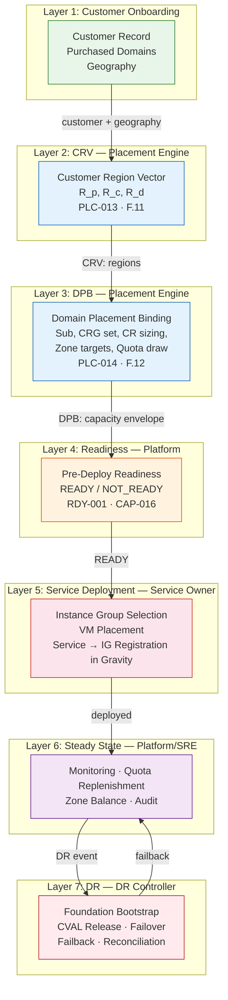

# ACRME End-to-End Deployment Chain with Placement Engine Ownership Layers

> **Revision 2** — Instance Group determination moved from DPB (Layer 3) to Service Deployment (Layer 5).
> DPB outputs the **capacity envelope** only. Service Owner determines IG.

## Ownership Boundary: What Is an Input vs an Output

| Concept | Role | Decided By |
|---------|------|------------|
| **Region placement** (CRV) | INPUT to service deployment | Placement Engine (Layer 2) |
| **Capacity envelope** (DPB) | INPUT to service deployment | Placement Engine (Layer 3) |
| **Instance Group** | OUTPUT of service deployment | Service Owner (Layer 5) |
| **Service → IG association** | Registration after deployment | Service Owner → Gravity (Layer 5) |

The Placement Engine tells service deployment **where** (regions) and **how much** (subscription, CRG set, CR sizing, zone targets, quota). The Service Owner then receives that context and decides **which Instance Group** to deploy into.

## Ownership Layer Summary

| Layer | Name | Owner | Scope | Key Outputs |
|-------|------|-------|-------|---------|
| 1 | Customer Onboarding | Commercial / Sales | Customer | Customer record, purchased domains |
| 2 | Customer Region Vector (CRV) | Placement Engine | Customer × Geography | R_p, R_c, R_d, distribution model |
| 3 | Domain Placement Binding (DPB) | Placement Engine | Domain × Environment | Subscription, CRG set, CR sizing, zone targets, quota draw |
| 4 | Pre-Deploy Readiness | Placement Engine / Platform | Domain × Environment × Region | READY / NOT_READY gate |
| 5 | Service Deployment | Service Owner / Product Automation | Service × Environment × Region | Instance Group, VM placement, runtime config |
| 6 | Steady-State Operations | Platform / SRE | Region × Environment | Monitoring, scaling, quota replenishment |
| 7 | DR Activation & Failback | DR Controller / Platform | Customer × DR Region | Foundation bootstrap, CVAL release, failover routing |

---

## Layer 1 — Customer Onboarding

**Owner:** Commercial / Sales  
**Scope:** Customer  
**Trigger:** Customer signs contract for one or more domain groups  

**Outputs:**
- Customer record (C) with purchased domain list
- Geography (G) — derived from customer's primary operating region or contractual requirement
- Initial environment requirements (Prod, CVAL, DR)

**Constraints:**
- No capacity or region decisions are made here
- Domain group tokens (DOM-001) are assigned but not yet bound to regions or subscriptions

---

## Layer 2 — Customer Region Vector (CRV)

**Owner:** Placement Engine  
**Scope:** Customer × Geography  
**Trigger:** First deployment request for customer C in geography G  
**Requirement:** PLC-013, F.11  

**Inputs:**
- Customer record (C, G)
- PlacementPolicy version (scoring weights, thresholds, distribution model)
- Regional capacity snapshot (all domain CRGs aggregated at customer scope)
- Hard constraints (HC-1..HC-11)

**Process:**
1. **Exact-Region Path (default, PLC-001):** Customer supplies R_p → validate against HC → derive R_c, R_d per distribution model
2. **Geography Path (exception, PLC-002):** Customer supplies G only → score all eligible regions → derive R_p, R_c, R_d

**Scoring (at customer aggregate — summed across all domains):**
```
Score_Pool(C,R) = α·capacity + β·quota + γ·fairness + δ·DR_readiness + ε·zones
```

**Distribution models (REG-003):**
- 3-region (US): R_p, R_c, R_d all potentially different
- 2-region (EU, AU, AP): R_c = R_d (mandatory co-location, PLC-010a)
- Cross-geo (ME): R_c = R_p (separate CRGs); R_d ∈ Europe (PLC-010b)

**Outputs:**
```
CRV(C,G) = {
  geography: G,
  distribution_model: "3-region" | "2-region" | "cross-geo",
  prod_region: R_p,
  cval_region: R_c,
  dr_region: R_d,
  policy_version: ver,
  engine_version: ver
}
```

**Constraints:**
- CRV is resolved ONCE per customer × geography (PLC-013)
- CRV is reused across ALL domain groups of that customer (DOM-001)
- CRV changes require approved migration workflow (PLC-005)
- CRV strictly precedes DPB (PLC-015)

---

## Layer 3 — Domain Placement Binding (DPB)

**Owner:** Placement Engine  
**Scope:** Domain Group × Environment  
**Trigger:** CRV resolved; domain requires capacity binding  
**Requirement:** PLC-014, F.12  

**Inputs:**
- CRV(C,G) — provides the region R for each environment E
- Domain group token (D, DOM-001)
- Environment (E ∈ {Prod, CVAL, DR})
- PlacementPolicy version

**Process — for each (D, E) with R = CRV(C,G).E:**

| Step | Output | Source |
|------|--------|--------|
| ① Subscription | Sub(D,E) = Resolve(C, D, E, R) | DOM-002 / shard registry |
| ② CRG set | Per CAP-025: crg-pr (Prod) · crg-cvdr (CVAL/DR shared) · crg-drf (DR Foundation) | CAP-025 |
| ③ CR sizing | TargetReserved = Allocated + Buffer | F.1, F.2, F.3 |
| ④ Zone targets | TargetVMs(z) = round(VMs / ZoneCount) | PLC-016, F.9 |
| ⑤ Quota draw | Central group cell (QUA-015), region × VM-family | QUA-015 |

**Outputs:**
```
DPB(D,E) = {
  subscription: Sub(D,E),
  crg_set: { type, crg_ids[] },
  cr_sizing: { target, headroom, deficit },
  zone_targets: { z1, z2, z3 },
  quota_draw: { group_cell, sub_allocation }
}
```

**What DPB does NOT do:**
- DPB does NOT determine Instance Group
- DPB does NOT re-run region scoring
- DPB does NOT weight or rank regions

**Determinism (DPB-GEN-002):**
Same CRV + same policy version → identical DPB outcome, replayable from the operation record.

---

## Layer 4 — Pre-Deploy Readiness

**Owner:** Placement Engine / Platform  
**Scope:** Domain × Environment × Region  
**Trigger:** DPB complete; deployment request queued  
**Requirement:** RDY-001, RDY-002, CAP-016, QUA-007  

**Readiness checks:**

| Check | Pass condition |
|-------|---------------|
| Subscription exists and is healthy | Sub(D,E) active, no policy blocks |
| CRG set provisioned | All CRGs in the set exist in the target region/zones |
| Reservations sized | Reserved ≥ TargetReserved (or deficit acknowledged) |
| Quota sufficient | AvailableQuota ≥ RequestedDeploymentUnits |
| Zone spread feasible | Target zones available in region |
| DR Foundation baseline present | crg-drf reserved (DR environment only) |

**Output:** `READY` | `NOT_READY` (with deficit codes: `QUOTA_DEFICIT`, `CR_DEFICIT`, `ZONE_UNAVAILABLE`, `STALE_STATE`)

**Constraint:** This is a fail-fast safety check (ADR-006), not a second enforcement gate.

---

## Layer 5 — Service Deployment

**Owner:** Service Owner / Product Automation  
**Scope:** Service × Environment × Region  
**Trigger:** Readiness = READY; Service Owner initiates deployment  

**Inputs (from Layers 2–4):**
- CRV region binding (which region)
- DPB capacity envelope (which subscription, CRG set, CR sizing, zone targets, quota)
- Readiness confirmation

**Service Owner decisions (NOT made by the Placement Engine):**
- **Instance Group selection** — which IG to deploy into, based on service architecture, shard strategy, and operational policy
- **VM sizing** — specific SKU selection within the reserved family
- **Deployment orchestration** — blue/green, canary, rolling update strategy

**Registration:**
- Service → IG association is registered in the global system of record (Gravity) during service registration
- This registration is the authoritative source for "which service runs in which IG"

**Outputs:**
- Deployed service instances in the target IG
- Updated IG membership in Gravity
- Capacity consumption recorded against the DPB envelope

---

## Layer 6 — Steady-State Operations

**Owner:** Platform / SRE  
**Scope:** Region × Environment  
**Trigger:** Continuous  

**Activities:**
- Capacity monitoring per domain CRG set
- Quota utilization tracking and threshold-based replenishment (QUA-015: 85% group, 85% subscription)
- Zone balance monitoring and rebalance recommendations (PLC-011, A.9)
- Combined region load observation across domains (PLC-016) — alert only, never reserve against it
- CRV/DPB audit trail maintenance
- Policy version drift detection

---

## Layer 7 — DR Activation & Failback

**Owner:** DR Controller / Platform  
**Scope:** Customer × DR Region  
**Trigger:** DR declaration event  

**DR activation sequence:**
1. DR Foundation (crg-drf) already running in DR region — platform foundation services (IAM, APIM, Kafka) are pre-bootstrapped
2. CVAL shared capacity (crg-cvdr) released for DR customer workloads (DR-005/DR-006)
3. DR consumer subscriptions swapped onto the shared CRG (FIN-008 single-cost accounting)
4. Workload failover routing activated
5. Zone spread maintained per DR zone targets

**Failback sequence:**
1. Workload routing returned to production region
2. DR consumer subscriptions disassociated
3. CVAL consumers re-associated
4. DR Foundation returns to standby monitoring
5. Capacity reconciliation and audit

**Constraints:**
- DR Foundation is never shared with routine CVAL consumption (DR-021)
- DR sizing uses max-not-sum (DR-017, A.6)
- Cross-geo DR (Middle East → Europe) uses dedicated capacity, not CVAL sacrifice (PLC-010b)

---

## Mermaid: Ownership Layer Flow



---

## Cross-Reference to Requirements

| Layer | Primary Requirements | Formulas |
|-------|---------------------|----------|
| 1 | DOM-001 | — |
| 2 | PLC-013, PLC-001/002, PLC-010/010a/010b, REG-003 | F.11, A.10 |
| 3 | PLC-014, PLC-015, CAP-025, QUA-015, DOM-002 | F.12, F.1–F.3, F.9 |
| 4 | RDY-001, RDY-002, CAP-016, QUA-007 | — |
| 5 | INT-003, INT-008 | — |
| 6 | OBS-001, OBS-002, PLC-011, PLC-016, QUA-015 | A.9 |
| 7 | DR-005, DR-006, DR-007, DR-017, DR-021, FIN-008 | A.6 |
