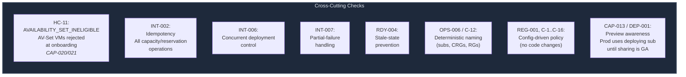

# ACRME End-to-End Deployment Flow — Diagram as Code

**Mermaid flowcharts covering the full Customer Onboarding → Placement → Service Deployment → Readiness → Steady State → DR pipeline.**

| | |
|---|---|
| **Version** | 1.0 |
| **Date** | 17 November 2026 |
| **Baseline** | v4.0.2 |
| **HC reference** | v1.1 (HC-1..HC-11) |

> **Reading guide:** The flow is split into five connected diagrams, each covering 2–3 phases. Terminal nodes in one diagram are entry nodes in the next. Every gate cites its normative requirement ID.

---

## Diagram 1 — Onboarding & CRV Resolution (Phases 0–1)

```mermaid
flowchart TD
    %% ── Phase 0: Customer Onboarding ──
    subgraph P0["Phase 0 — Customer Onboarding"]
        direction TB
        A0(["AEP Intent Received"]) --> A1{"Customer exists?\n<i>PLC-003, DAT-001</i>"}
        A1 -->|Yes| A2["Fetch cached CRV\nfrom seed record"]
        A1 -->|No — new customer| A3["Geography Selection\n<i>REG-001</i>"]
        A3 --> A4{"Distribution model?\n<i>REG-003</i>"}
        A4 -->|US| A5["three_region"]
        A4 -->|EU / AU / APAC| A6["two_region"]
        A4 -->|ME| A7["cross_geography_dr"]
        A5 --> A8(["Proceed to CRV"])
        A6 --> A8
        A7 --> A8
    end

    %% ── Phase 1: CRV Resolution ──
    subgraph P1["Phase 1 — CRV Resolution  (Customer × Geography — resolved ONCE)"]
        direction TB

        %% Step 1.1 — Pre-filtering
        B0(["Candidate Set\nFormation"]) --> B1
        B1{{"HC-8: GEOGRAPHY_CONTAINMENT\nRegion ∈ customer's geography"}} --> B2
        B2{{"HC-9: STANDARD_REGION_ONLY\nOnly Standard-class eligible"}} --> B3["Candidate set:\nStandard regions\nwithin geography"]

        %% Step 1.2 — Hard Constraint Gate
        B3 --> C0(["Hard Constraint Gate\n(binary pass / fail)"])
        C0 --> C1{{"HC-1: REGION_SEPARATION\nProd ≠ DR, Prod ≠ CVAL"}}
        C1 --> C2{{"HC-2: CAPACITY_FLOOR\nSufficient reservable capacity"}}
        C2 --> C3{{"HC-3: QUOTA_FLOOR\nQuota headroom after\nProd floor + DR earmark"}}
        C3 --> C4{{"HC-4: DR_SEPARATION_CLASS\nDR class ≥ Prod class"}}
        C4 --> C5{{"HC-5: ZONE_AVAILABILITY\naz_count ≥ 1"}}
        C5 --> C6{{"HC-6: DR_COVERAGE_FLOOR\nDestination absorbs\nprotected Prod portion"}}
        C6 --> C7{{"HC-7: DR_FLOOR_INTEGRITY\nDR earmark not consumed\nby NonProd"}}
        C7 --> C8{{"HC-10: CROSS_GEO_EXTENSION\nApproved extension path"}}
        C8 --> C9{"All HCs pass?"}
        C9 -->|Fail| CX[/"Region excluded\nfrom scoring"/]
        C9 -->|Pass| D0

        %% Step 1.3 — Scoring
        D0(["Scoring — Weighted\nCapacity Placement\n<i>PLC-007/008, F.11</i>"])
        D0 --> D1["PS_Prod(C,R)\nα=0.30 β=0.25\nγ=0.20 δ=0.15 ε=0.10"]
        D0 --> D2["PS_NonProd(C,R)\nα=0.15 β=0.25\nγ=0.20 δ=0.30 ε=0.10"]
        D0 --> D3["PS_DR(C,R)\nα=0.30 β=0.20\nγ=0.15 δ=0.15 ε=0.10 ζ=0.10"]
        D1 --> E0
        D2 --> E0
        D3 --> E0

        %% Step 1.4 — Region Assignment
        E0{"Assignment per\ndistribution model"}
        E0 -->|three_region| E1["Prod = argmax PS_Prod\nCVAL = argmax PS_NonProd (remaining)\nDR = argmax PS_DR (remaining)"]
        E0 -->|two_region| E2["Prod = argmax PS_Prod\nCVAL + DR = remaining region\n<i>PLC-010a — deterministic</i>"]
        E0 -->|cross_geo_dr| E3["Prod + CVAL = ME region\nDR = argmax PS_DR\nover Europe Standard\n<i>PLC-010b, DR-020</i>"]

        %% Step 1.5 — Output
        E1 --> F0
        E2 --> F0
        E3 --> F0
        F0["CRV = (geo, model,\nR_p, R_c, R_d)\n<i>PLC-013</i>"]
        F0 --> F1[("Seed Record\npersisted\n<i>PLC-003, DAT-001</i>")]
        F1 --> F2{{"RDY-004: Freshness\nseed age ≤ max age"}}
        F2 --> F3(["CRV locked — immutable\nChange → PLC-005 migration"])
    end

    A8 --> B0
    A2 --> DPB_ENTRY(["Skip to DPB\n(Phase 2)"])

    style P0 fill:#1e1b4b,stroke:#6366f1,stroke-width:2px,color:#e0e7ff
    style P1 fill:#172554,stroke:#3b82f6,stroke-width:2px,color:#dbeafe
    style CX fill:#7f1d1d,stroke:#ef4444,color:#fecaca

    classDef gate fill:#1c1917,stroke:#ef4444,stroke-width:2px,color:#fca5a5
    classDef decision fill:#1c1917,stroke:#f59e0b,stroke-width:2px,color:#fde68a
    classDef output fill:#022c22,stroke:#22c55e,stroke-width:1px,color:#bbf7d0
    classDef start fill:#0f172a,stroke:#94a3b8,stroke-width:1px,color:#e2e8f0

    class B1,B2,C1,C2,C3,C4,C5,C6,C7,C8,F2 gate
    class A1,A4,C9,E0 decision
    class B3,F0 output
    class A0,B0,C0,D0 start
```

---

## Diagram 2 — DPB Resolution (Phase 2)

```mermaid
flowchart TD
    subgraph P2["Phase 2 — DPB Resolution  (Per Domain D × Environment E × CRV Region R)"]
        direction TB

        G0(["CRV available\n(from Phase 1)"]) --> G1
        G1{{"PLC-015: Two-Phase Gate\nCRV strictly precedes DPB\n<i>VR-14</i>"}}
        G1 --> G2(["Iterate per (D, E) pair"])

        %% Step 2.1 — Subscription
        G2 --> H0
        subgraph S1["① Subscription Resolution"]
            H0["Resolve subscription\nfor (D, E, R)"]
            H0 --> H1{{"DOM-002: One sub\nper Domain × Env"}}
            H1 --> H2["Deterministic naming\n<i>OPS-006, C-12</i>\nsub-org-product-env-domain-region-shard"]
            H2 --> H3{"At capacity?"}
            H3 -->|Yes| H4["Shard registry → next shard\n<i>ADR-007 §10</i>"]
            H3 -->|No| H5
            H4 --> H5["Subscription ID"]
        end

        %% Step 2.2 — CRG Set
        H5 --> I0
        subgraph S2["② CRG Set Assignment"]
            I0{"Environment?"}
            I0 -->|Prod| I1["crg-pr-* (dedicated)\nENV-003"]
            I0 -->|CVAL| I2["crg-cvdr-* (shared\nwith DR within domain)\nENV-003"]
            I0 -->|DR| I3["crg-drf-* (Foundation)\n+ crg-cvdr-* on declaration\nDR-021"]
            I1 --> I4
            I2 --> I4
            I3 --> I4
            I4{{"DOM-004 / VR-12:\nDomain-bounded isolation\nNo cross-domain sharing"}}
            I4 --> I5{{"CAP-025 / VR-13:\nSet types never mixed\nwithin a domain"}}
            I5 --> I6["Zone structure\n<i>CAP-023</i>\nzonal + per-AZ + reg CRGs"]
            I6 --> I7{"CRG set exists?"}
            I7 -->|No| I8["Create with seed-at-0\n<i>CAP-022</i>"]
            I7 -->|Yes| I9["Bind to existing"]
            I8 --> I10["CRG Set IDs"]
            I9 --> I10
        end

        %% Step 2.3 — CR Sizing
        I10 --> J0
        subgraph S3["③ CR Sizing (Reservation Target)"]
            J0["Target = Allocated + Buffer\n<i>CAP-003, F.1</i>"]
            J0 --> J1["Buffer = configurable policy\n<i>C-1 — never fixed %</i>"]
            J1 --> J2{"Environment?"}
            J2 -->|DR| J3["Max-not-sum sizing\nDR_Req(d) = MAX_s(portion)\n<i>DR-017, F.6</i>"]
            J2 -->|DR Foundation| J4["Bootstrap baseline\n<i>DR-021, ENV-005, C-16</i>"]
            J2 -->|Prod / CVAL| J5["Standard sizing\nper SKU × zone"]
            J3 --> J6
            J4 --> J6
            J5 --> J6
            J6["Headroom = Reserved − Allocated  (F.2)\nDeficit = max(0, Target − Reserved)  (F.3)"]
            J6 --> J7{{"CAP-015: No double counting\nCVAL earmark ≠ CVAL headroom"}}
            J7 --> J8["CR targets per\n(D, E, R, SKU, zone)"]
        end

        %% Step 2.4 — Zone Distribution
        J8 --> K0
        subgraph S4["④ Zone Distribution Targets"]
            K0["Target = round(VMs / ZoneCount)\n<i>PLC-016, F.9</i>"]
            K0 --> K1["Preferred zone = argmin_z VMs(D,E,z)"]
            K1 --> K2{"Skew > tolerance?\n<i>C-13</i>"}
            K2 -->|Yes| K3["Rebalance\nrecommendation"]
            K2 -->|No| K4["Zone targets OK"]
            K3 --> K5
            K4 --> K5
            K5["Combined-load observation\nΣ_D VMs(D,E,R,z)\n<i>OBS-002, C-15</i>\n⚠ Alert only — never enforcement"]
        end

        %% Step 2.5 — Quota Draw
        K5 --> L0
        subgraph S5["⑤ Quota Draw"]
            L0["Central quota group\n<i>QUA-015</i>\nAll domain subs in one group\nper region × VM-family"]
            L0 --> L1{{"QUA-002 / RDY-001:\nTwo-cap check\nVM-family cap AND\ntotal regional vCPU cap"}}
            L1 --> L2["Available = min(FamilyCap−Used,\nRegionalCap−Used)  (F.4)"]
            L2 --> L3{"Deficit?\n<i>F.5</i>"}
            L3 -->|Yes| L4["Quota transfer\nfrom group → sub"]
            L3 -->|No| L5["Quota OK"]
            L4 --> L6{"Group ≥ 85%?"}
            L5 --> L7
            L6 -->|Yes| L6a["Group-level\nincrease request"]
            L6 -->|No| L7
            L6a --> L7
            L7["Quota draw resolved\n<i>QUA-014: audit logged</i>"]
        end

        %% DPB Output
        L7 --> M0
        M0[/"DPB Output: Capacity Envelope\n───────────────────────\nSubscription · CRG Set IDs\nCR Sizing · Zone Targets\nQuota Draw\n───────────────────────\n⚠ Does NOT include\nInstance Group"/]
    end

    style P2 fill:#0c4a6e,stroke:#06b6d4,stroke-width:2px,color:#cffafe
    style M0 fill:#022c22,stroke:#22c55e,stroke-width:2px,color:#bbf7d0

    classDef gate fill:#1c1917,stroke:#ef4444,stroke-width:2px,color:#fca5a5
    classDef decision fill:#1c1917,stroke:#f59e0b,stroke-width:2px,color:#fde68a
    classDef substep fill:#1e293b,stroke:#06b6d4,stroke-width:1px,color:#e0f2fe

    class G1,H1,I4,I5,J7,L1 gate
    class H3,I0,I7,J2,K2,L3,L6 decision
    class S1,S2,S3,S4,S5 substep
```

---

## Diagram 3 — Readiness Gate & Platform Foundation (Phases 3–4)

```mermaid
flowchart TD
    subgraph P3["Phase 3 — Readiness Gate  (Pre-Deploy — ALL must pass)"]
        direction TB

        N0(["DPB Capacity Envelope\nreceived"]) --> N1

        subgraph RDY["RDY-001: 12-Point Readiness Check"]
            N1{{"1. Target region approved"}}
            N1 --> N2{{"2. Zone supported\n<i>CAP-016: logical→physical</i>"}}
            N2 --> N3{{"3. SKU supported\nin scope file"}}
            N3 --> N4{{"4. Reservation policy known\nProd=mandatory (CAP-017)\nOthers=configurable (ENV-002)"}}
            N4 --> N5{{"5. Reservation exists\n(if required)"}}
            N5 --> N6{{"6. Consumer sub authorised\n(if shared) ≤100 subs\n<i>CAP-013, DOM-004</i>"}}
            N6 --> N7{{"7. Sufficient reservation\nor approved over-allocation"}}
            N7 --> N8{{"8. Quota: VM-family\nvCPU cap\n<i>QUA-002</i>"}}
            N8 --> N9{{"9. Quota: total regional\nvCPU cap\n<i>QUA-002</i>"}}
            N9 --> N10{{"10. Records fresh\n<i>RDY-004: age ≤ max</i>"}}
            N10 --> N11{{"11. No blocking\npolicy/exception"}}
            N11 --> N12{{"12. Capacity & quota\nbalanced\n<i>RDY-003</i>"}}
        end

        subgraph CVAL["CAP-016: Reservation Integrity"]
            N12 --> O1{{"Reservation exists\nin target sub"}}
            O1 --> O2{{"SKU match"}}
            O2 --> O3{{"Region match"}}
            O3 --> O4{{"Zone match (physical)\nconsumer→provider zone"}}
            O4 --> O5{{"Consumer authorised\n(if shared)"}}
            O5 --> O6{{"Quantity sufficient"}}
            O6 --> O7{{"Quota available\n(both caps)"}}
        end

        O7 --> P{"All pass?"}
        P -->|No| Q0
        P -->|Yes| Q1

        subgraph STATES["RDY-002: Readiness States"]
            Q0[/"QUOTA_DEFICIT\nRESERVATION_DEFICIT\nCAPACITY_UNAVAILABLE\nSTALE_STATE\nPOLICY_BLOCKED\nVALIDATION_REQUIRED"/]
        end

        Q1["✅ READY\n(or READY_WITH_RISK)"]
    end

    %% ── Phase 4: Platform Foundation ──
    subgraph P4["Phase 4 — Platform Foundation  (Per region)"]
        direction TB
        Q1 --> R1["Product cell provisioning\nNetworking, control plane,\noperators"]
        R1 --> R2["Desired state application\nPlatform operators apply\nDPB envelope config"]
        R2 --> R3["In-region HA setup\nZone redundancy\n<i>CAP-023</i>"]
        R3 --> R4(["Foundation ready →\nProceed to Service Deployment"])
    end

    style P3 fill:#450a0a,stroke:#ef4444,stroke-width:2px,color:#fecaca
    style P4 fill:#2e1065,stroke:#8b5cf6,stroke-width:2px,color:#ede9fe
    style Q0 fill:#7f1d1d,stroke:#ef4444,color:#fecaca
    style Q1 fill:#14532d,stroke:#22c55e,stroke-width:2px,color:#bbf7d0

    classDef gate fill:#1c1917,stroke:#ef4444,stroke-width:2px,color:#fca5a5
    classDef decision fill:#1c1917,stroke:#f59e0b,stroke-width:2px,color:#fde68a

    class N1,N2,N3,N4,N5,N6,N7,N8,N9,N10,N11,N12,O1,O2,O3,O4,O5,O6,O7 gate
    class P decision
```

---

## Diagram 4 — Service Deployment, IG Lifecycle & Production Go-Live (Phases 5–7)

```mermaid
flowchart TD
    %% ── Phase 5: Service Deployment ──
    subgraph P5["Phase 5 — Service Deployment  (Service Owner scope)"]
        direction TB

        S0(["Receive CRV + DPB\ncapacity envelope"]) --> S1

        S1{{"INT-001: Capacity API\ncalled before first deploy"}}
        S1 --> S2{{"INT-003/008: Required\ninput present\n(customer, domain token,\nproduct, env, region,\nSKU+count, zone, priority,\ncorrelation ID)"}}
        S2 --> S3{{"PLC-015: Two-scope\nordering enforced\nCRV precedes DPB"}}

        S3 --> S4["⚠ SERVICE OWNER\ndetermines Instance Group\n───────────────────\nIG = output of service\ndeployment, NOT input\nfrom placement engine"]

        S4 --> S5["IG definition →\nIG selection\n(domain, service type,\noperational requirements)"]

        S5 --> S6["VM / VMSS association\nwith reservation reference\n<i>INT-005</i>"]

        S6 --> S7{{"INT-006: Concurrent\ndeployment control\nNo two decisions consume\nsame last unit"}}

        S7 --> S8{"Deploy\nsucceeded?"}
        S8 -->|No| S9["Partial-failure handling\nRecord partial state,\ncompensate or raise task\n<i>INT-007</i>"]
        S8 -->|Yes| S10

        S9 --> S10{{"INT-002: Idempotent\noperations\n(retry safe)"}}

        S10 --> S11[("Service ↔ IG\nregistered in Gravity\n<i>Global system of record</i>")]
    end

    %% ── Phase 6: IG Lifecycle ──
    subgraph P6["Phase 6 — IG Provisioning / Scaling  (DevOps lifecycle)"]
        direction TB
        S11 --> T1["IG provisioning\nwith DPB envelope context"]
        T1 --> T2{"Primary sub\nat limits?"}
        T2 -->|Yes| T3["Shard registry →\nnext shard (-02, -03)\n<i>ADR-007 §10, DOM-003</i>"]
        T2 -->|No| T4
        T3 --> T4["Reactive SKU/AZ\ndiscovery reconciled\n<i>CAP-024, CAP-019</i>"]
        T4 --> T5["Seed reservations\nscale up from 0\n<i>CAP-022</i>"]
    end

    %% ── Phase 7: Production Readiness ──
    subgraph P7["Phase 7 — Production Readiness & Go-Live  (SRE / Ops)"]
        direction TB
        T5 --> U1{{"Health endpoint\nexposed and healthy"}}
        U1 --> U2{{"Dependency validation\nAll deps reachable"}}
        U2 --> U3{{"Synthetic checks pass\nEnd-to-end flow"}}
        U3 --> U4{{"Business checks pass"}}
        U4 --> U5{{"One-writer-per-realm\nPartition safety"}}
        U5 --> U6{{"DR readiness certified\nFoundation tests complete\nwith recorded evidence\n<i>ENV-005, DR-021</i>"}}
        U6 --> U7{{"Failover capacity reserved\nWarm replicas in failover PIN\n⚠ Onboarding rejected\nif not reserved"}}
        U7 --> U8["✅ PRODUCTION LIVE"]
    end

    style P5 fill:#451a03,stroke:#f59e0b,stroke-width:2px,color:#fef3c7
    style P6 fill:#431407,stroke:#f97316,stroke-width:2px,color:#ffedd5
    style P7 fill:#052e16,stroke:#22c55e,stroke-width:2px,color:#dcfce7
    style S4 fill:#422006,stroke:#f59e0b,stroke-width:2px,color:#fef3c7
    style U8 fill:#14532d,stroke:#22c55e,stroke-width:3px,color:#bbf7d0

    classDef gate fill:#1c1917,stroke:#ef4444,stroke-width:2px,color:#fca5a5
    classDef decision fill:#1c1917,stroke:#f59e0b,stroke-width:2px,color:#fde68a

    class S1,S2,S3,S7,S10,U1,U2,U3,U4,U5,U6,U7 gate
    class S8,T2 decision
```

---

## Diagram 5 — Steady State & DR Activation (Phases 8–9)

```mermaid
flowchart TD
    %% ── Phase 8: Steady State ──
    subgraph P8["Phase 8 — Steady State Operations  (Ongoing)"]
        direction TB
        V0(["Customer is\nProduction Live"]) --> V1

        V1["Reconciliation cycle\nReservations, quota, scope file\n<i>CAP-019, CAP-024</i>"]
        V1 --> V2["Buffer management\nConfigurable policy\n<i>CAP-003, C-1</i>"]
        V2 --> V3["Quota monitoring\nGroup + sub replenishment\nat 85% thresholds\n<i>QUA-015</i>"]
        V3 --> V4["Zone rebalancing\nPer-domain drift\n<i>PLC-016, C-13</i>"]
        V4 --> V5["Combined-load observation\nCross-domain alert only\n<i>OBS-002, C-15</i>"]
        V5 --> V6["Idle cost measurement\n<i>FIN-001</i>"]
        V6 --> V7["Audit trail\n<i>QUA-014</i>"]
        V7 --> V8["DR drill rotation\nPeriodic, seed preserved\n<i>DR-012</i>"]
    end

    %% ── Phase 9: DR Activation ──
    subgraph P9["Phase 9 — Disaster Recovery Activation"]
        direction TB

        %% Step 9.1 — Detection & Declaration
        W0(["⚡ Regional Failure\nDetected"]) --> W1
        W1{{"DR-001: Single-region\nfailure basis confirmed"}}
        W1 --> W2{{"DR-010: DR declaration\nauthorised\n(destructive actions gated)"}}
        W2 --> W3{{"DR-011: Source region\ncapacity excluded\nfrom calculations"}}

        %% Step 9.2 — DR Index
        W3 --> W4[("DR-018: Query\nsource→destination\nDR index\nBidirectional mapping")]
        W4 --> W5["Identify affected\ncustomers, realms,\nstandby instances\n<i>DR-019</i>"]

        %% Step 9.3 — Staged Acquisition
        W5 --> X0(["DR-006: Staged\nCapacity Acquisition"])
        X0 --> X1["Stage 1: DR Foundation\nbootstrap headroom\ncrg-drf-* (always present)\n<i>DR-021</i>"]
        X1 --> X2["Stage 2: Available\nreservation + quota\nin destination"]
        X2 --> X3["Stage 3: CVAL sacrifice\nShut down eligible CVAL\nRelease crg-cvdr-*\n<i>DR-005/006</i>"]
        X3 --> X4["Stage 4: Share / reassign\nreservations\nDomain-bounded\n<i>CAP-013, DOM-004</i>"]
        X4 --> X5["Stage 5: Allocate pooled\nquota to DR subs\n<i>QUA-015</i>"]
        X5 --> X6["Stage 6: Request\nadditional Azure\nquota/capacity"]
        X6 --> X7["Stage 7: Report\nunrecoverable gaps"]

        %% Step 9.4 — Activation
        X7 --> Y0(["Standby Activation"])
        Y0 --> Y1["DR-008: Control plane first\nPlatform CPs before\ncustomer workloads"]
        Y1 --> Y2["DR-019/009: Activate\nstandby → active\nP0/P-1 priority order"]
        Y2 --> Y3["Per-domain activation\nDR Foundation + CVAL extension\n<i>DOM-003, DR-021</i>"]

        %% Step 9.5 — Routing
        Y3 --> Z1["Stop routing to\nfailed region"]
        Z1 --> Z2["Promote warm\ndata replicas"]
        Z2 --> Z3["Update placement\nand APIM routing"]
        Z3 --> Z4["Deploy Service-0\nin failover PIN"]

        %% Step 9.6 — Failback
        Z4 --> Z5{"Failback policy\n<i>DR-013, C-5</i>"}
        Z5 -->|Extended| Z6["~1 year DR run\n(preferred)"]
        Z5 -->|Earlier| Z7["~30 days to\nprove failback"]
        Z6 --> Z8
        Z7 --> Z8
        Z8["Seed/state/audit trail\npreserved through failback\n<i>DR-012</i>"]
        Z8 --> Z9(["Return to\nSteady State"])
    end

    V8 -.->|"⚡ Regional failure"| W0
    Z9 -.-> V0

    style P8 fill:#042f2e,stroke:#14b8a6,stroke-width:2px,color:#ccfbf1
    style P9 fill:#500724,stroke:#ec4899,stroke-width:2px,color:#fce7f3
    style W0 fill:#7f1d1d,stroke:#ef4444,stroke-width:2px,color:#fecaca
    style Z9 fill:#14532d,stroke:#22c55e,stroke-width:1px,color:#bbf7d0

    classDef gate fill:#1c1917,stroke:#ef4444,stroke-width:2px,color:#fca5a5
    classDef decision fill:#1c1917,stroke:#f59e0b,stroke-width:2px,color:#fde68a
    classDef stage fill:#1e293b,stroke:#ec4899,stroke-width:1px,color:#fce7f3

    class W1,W2,W3 gate
    class Z5 decision
    class X1,X2,X3,X4,X5,X6,X7 stage
```

---

## Cross-Cutting Checks (Apply Across All Phases)

---

## Traceability: Diagram → Requirement

| Diagram | Phases | Checks applied | Key requirement IDs |
|---------|--------|---------------|---------------------|
| 1 — Onboarding & CRV | 0–1 | Seed lookup, HC gate (HC-1..HC-10), scoring | PLC-003/009, HC-1..HC-10, PLC-007/008/013, F.10/F.11 |
| 2 — DPB Resolution | 2 | 5-step pipeline: sub, CRG, CR, zone, quota | PLC-014/015, DOM-002, CAP-025, CAP-003, PLC-016, QUA-015, F.1–F.5/F.9 |
| 3 — Readiness & Foundation | 3–4 | 12-point readiness, reservation integrity | RDY-001..004, CAP-016 |
| 4 — Service & Go-Live | 5–7 | IG determination, VM association, go-live gate | INT-001..008, ENV-005, DR-021 |
| 5 — Steady State & DR | 8–9 | Reconciliation, 7-stage DR acquisition, failback | CAP-019, QUA-015, DR-001..021, F.6–F.8 |
| Cross-cutting | All | HC-11, idempotency, naming, preview | HC-11, INT-002/006/007, OPS-006, DEP-001 |
