# ACRME End-to-End Deployment Flow — Diagram as Code

**Mermaid flowcharts covering the full Customer Onboarding → Placement → Service Deployment → Readiness → Steady State → DR pipeline.**

| | |
|---|---|
| **Version** | 2.0 |
| **Date** | 17 November 2026 |
| **Baseline** | v4.0.2 |
| **HC reference** | v1.1 (HC-1..HC-11) |

**Companion deployment flow:** [ACRME End-to-End Deployment Flow v2.0](./ACRME_End_to_End_Deployment_Flow_v2.md)
**Change record:** [Proposed changes and rationale](./ACRME_E2E_Deployment_Flow_Diagrams_Proposed_Changes.md)

> **Reading guide:** Five connected phase diagrams cover the full pipeline; a sixth diagram lists cross-cutting checks. Terminal nodes in one diagram are entry nodes in the next. Baseline gates cite their requirement IDs; deployment-standard settings are identified separately and do not prove runtime enforcement.

| Version | Date | Change |
|---|---|---|
| 1.0 | 17 November 2026 | Historical diagram set, preserved in `ACRME_E2E_Deployment_Flow_Diagrams.md`. |
| 2.0 | 17 November 2026 | Aligns paths and gate scopes with flow v2.0 and baseline v4.0.2; corrects Instance Group timing, deployment-standard checks, reconciliation safeguards, and DR/failback. |

---

## Diagram 1 — Onboarding & CRV Resolution (Phases 0–1)

```mermaid
flowchart TD
    %% ── Phase 0: Customer Onboarding ──
    subgraph P0["Phase 0 — Customer Onboarding"]
        direction TB
        A0(["AEP Intent Received"]) --> A1{"Customer exists?\n<i>PLC-003, DAT-001</i>"}
        A1 -->|Yes| A2["Fetch cached CRV\nfrom seed record"]
        A1 -->|No — new customer| A3["Placement input\nExact Prod region by default\n<i>PLC-001</i>"]
        A3 --> A4{"Input path?"}
        A4 -->|Exact-region default| A5["Validate supplied Prod region;\ndo not score or replace it\n<i>PLC-001</i>"]
        A5 --> A5A{"Restricted Prod region?\n<i>HC-9</i>"}
        A5A -->|No — Standard| A8
        A5A -->|Yes| A5B{"Approved exception?"}
        A5B -->|No| AFAIL
        A5B -->|Yes| A8
        A4 -->|Geography exception| A6{"Explicit approval +\ncustomer acknowledgement?\n<i>PLC-002, DEC-003</i>"}
        A6 -->|No| AFAIL[/"Stop: exception\nnot approved"/]
        A6 -->|Yes| A7["Geography path\nEngine selects Prod, CVAL, DR"]
        A5 --> A8{"Distribution model?\n<i>REG-003</i>"}
        A7 --> A8
        A8 -->|US| A9["three_region"]
        A8 -->|EU / AU / APAC| A10["two_region"]
        A8 -->|ME| A11["cross_geography_dr"]
    end

    %% ── Phase 1: CRV Resolution ──
    subgraph P1["Phase 1 — CRV Resolution  (Customer × Geography — resolved ONCE)"]
        direction TB

        %% Step 1.1 — Pre-filtering
        B0(["Form candidates for\nregions engine selects"]) --> B1
        B1{{"HC-8: GEOGRAPHY_CONTAINMENT\nGeography path + configured\ncross-geo policy"}} --> B2
        B2{{"HC-9: STANDARD_REGION_ONLY\nAuto-selected regions are Standard;\nexplicit Restricted Prod only via\napproved exception"}} --> B3["Candidate set:\neligible Standard regions for\nengine-selected regions;\nexact Prod is validated input"]

        %% Step 1.2 — Hard Constraint Gate
        B3 --> C0(["CRV Region Gates\n(binary pass / fail)"])
        C0 --> C1{{"HC-1: REGION_SEPARATION\nApply model-specific region rules;\nME Prod+CVAL co-locate in separate CRGs"}}
        C1 --> C4{{"HC-4: DR_SEPARATION_CLASS\nDR class meets required\nseparation from Prod"}}
        C4 --> C5{{"HC-5: ZONE_AVAILABILITY\nAt least 2 physical AZs\nfor non-dev placement"}}
        C5 --> C8{{"HC-10: CROSS_GEO_EXTENSION\nOnly for cross-geo DR;\napproved path required"}}
        C8 --> C9{"All applicable region\ngates pass?"}
        C9 -->|Fail| CX[/"Stop / exclude failed\ncandidate as applicable"/]
        C9 -->|Pass| D0

        %% Step 1.3 — Scoring
        D0(["Customer-aggregate weighted\nplacement policy\n<i>PLC-007/008, F.10/F.11</i>"])
        D0 --> D1["Prod: exact path validates\nand holds supplied region;\ngeography exception scores"]
        D0 --> D2["CVAL / DR: score eligible\ncandidates per configured\npolicy and distribution model"]
        D1 --> E0
        D2 --> E0

        %% Step 1.4 — Region Assignment
        E0{"Assignment per\ndistribution model"}
        E0 -->|three_region| E1["Prod = exact input or approved-path selection\nCVAL / DR = eligible non-Prod regions;\ndistinct in current US model"]
        E0 -->|two_region| E2["Prod = exact input or approved-path selection\nCVAL = DR = sole remaining region\n<i>PLC-010a</i>"]
        E0 -->|cross_geo_dr| E3["Prod + CVAL = same ME region,\nseparate CRGs; DR = weighted-selected\nEurope Standard, dedicated capacity\nNo CVAL sacrifice; honor DR_NOT_OFFERED\n<i>PLC-010b, DR-020, DR-014</i>"]

        %% Step 1.5 — Output
        E1 --> F0
        E2 --> F0
        E3 --> F0
        F0["CRV = (geo, model,\nR_p, R_c, R_d)\n<i>PLC-013</i>"]
        F0 --> F1[("Seed Record\npersisted\n<i>PLC-003, DAT-001</i>")]
        F1 --> F2{{"RDY-004: Freshness\nseed age ≤ max age"}}
        F2 --> F3(["CRV locked — immutable\nChange → PLC-005 migration"])
    end

    A9 --> B0
    A10 --> B0
    A11 --> B0
    A2 --> DPB_ENTRY(["Skip to DPB\n(Phase 2)"])

    style P0 fill:#1e1b4b,stroke:#6366f1,stroke-width:2px,color:#e0e7ff
    style P1 fill:#172554,stroke:#3b82f6,stroke-width:2px,color:#dbeafe
    style CX fill:#7f1d1d,stroke:#ef4444,color:#fecaca
    style AFAIL fill:#7f1d1d,stroke:#ef4444,color:#fecaca

    classDef gate fill:#1c1917,stroke:#ef4444,stroke-width:2px,color:#fca5a5
    classDef decision fill:#1c1917,stroke:#f59e0b,stroke-width:2px,color:#fde68a
    classDef output fill:#022c22,stroke:#22c55e,stroke-width:1px,color:#bbf7d0
    classDef start fill:#0f172a,stroke:#94a3b8,stroke-width:1px,color:#e2e8f0

    class B1,B2,C1,C4,C5,C8,F2 gate
    class A1,A4,A5A,A5B,A6,A8,C9,E0 decision
    class B3,F0 output
    class A0,B0,C0,D0 start
```

---

## Diagram 2 — DPB Resolution (Phase 2)

```mermaid
flowchart TD
    subgraph P2["Phase 2 — DPB Resolution  (Per Domain D × Environment E × CRV Region R)"]
        direction TB

        G0(["CRV available\n(from Phase 1)"]) --> G1
        G1{{"PLC-015: Two-Phase Gate\nCRV strictly precedes DPB\n<i>VR-14</i>"}}
        G1 --> G2(["Iterate per (D, E) pair"])

        %% Step 2.1 — Subscription
        G2 --> H0
        subgraph S1["① Subscription Resolution"]
            H0["Resolve subscription\nfor (D, E, R)"]
            H0 --> H1{{"DOM-002: One sub\nper Domain × Env"}}
            H1 --> H2["Deterministic naming\n<i>OPS-006, C-12</i>\nsub-org-product-env-domain-region-shard"]
            H2 --> H3{"Configured scale-out\ntrigger reached?"}
            H3 -->|Yes| H4["Provision next compute sub\nonly under standard limit /\nheadroom policy"]
            H3 -->|No| H5
            H4 --> H5["Subscription ID"]
        end

        %% Step 2.2 — CRG Set
        H5 --> I0
        subgraph S2["② CRG Set Assignment"]
            I0{"Environment?"}
            I0 -->|Prod| I1["crg-pr-* (dedicated)\nENV-003"]
            I0 -->|CVAL| I2["crg-cvdr-* (same domain)\nDR extension only after\napproved declaration + gates\nCAP-025, DEP-001"]
            I0 -->|DR| I3["Dedicated crg-drf-* Foundation\nalways present + quota pre-staged;\nCVAL extension is conditional\nDR-021"]
            I1 --> I4
            I2 --> I4
            I3 --> I4
            I4{{"DOM-004 / VR-12:\nDomain-bounded isolation\nNo cross-domain sharing"}}
            I4 --> I5{{"CAP-025 / VR-13:\nSet types never mixed\nwithin a domain"}}
            I5 --> I6["Zone structure (CAP-023)\nDefault: one zonal CRG;\none CR per VM size per zone\nOptional per-zone CRGs;\nno-zone reg CRG is pinned to one zone"]
            I6 --> I7{"CRG set exists?"}
            I7 -->|No| I8["Create with seed-at-0\n<i>CAP-022</i>"]
            I7 -->|Yes| I9["Bind to existing"]
            I8 --> I10["CRG Set IDs"]
            I9 --> I10
        end

        %% Step 2.3 — CR Sizing
        I10 --> J0
        subgraph S3["③ CR Sizing (Reservation Target)"]
            J0["Target = Allocated + Buffer\n<i>CAP-003, F.1</i>"]
            J0 --> J1["Production buffer = configurable\n<i>C-2 — never fixed %</i>"]
            J1 --> J2{"Environment?"}
            J2 -->|DR| J3["Max-not-sum sizing\nDR_Req(d) = MAX_s(portion)\n<i>DR-017, F.6</i>"]
            J2 -->|DR Foundation| J4["Bootstrap baseline\n<i>DR-021, ENV-005, C-16</i>"]
            J2 -->|Prod / CVAL| J5["Standard sizing\nper SKU × zone"]
            J3 --> J6
            J4 --> J6
            J5 --> J6
            J6["Headroom = Reserved − Allocated  (F.2)\nDeficit = max(0, Target − Reserved)  (F.3)"]
            J6 --> J7{{"CAP-015: No double counting\nCVAL earmark ≠ CVAL headroom"}}
            J7 --> J8["CR targets per\n(D, E, R, SKU, zone)"]
        end

        %% Step 2.4 — Zone Distribution
        J8 --> K0
        subgraph S4["④ Zone Distribution Targets"]
            K0["Target = round(VMs / ZoneCount)\n<i>PLC-016, F.9</i>"]
            K0 --> K1["Preferred zone = argmin_z VMs(D,E,z)"]
            K1 --> K2{"Skew > tolerance?\n<i>C-13</i>"}
            K2 -->|Yes| K3["Rebalance\nrecommendation"]
            K2 -->|No| K4["Zone targets OK"]
            K3 --> K5
            K4 --> K5
            K5["Combined-load observation\nΣ_D VMs(D,E,R,z)\n<i>OBS-002, C-15</i>\n⚠ Alert only — never enforcement"]
        end

        %% Step 2.5 — Quota Draw
        K5 --> L0
        subgraph S5["⑤ Quota Draw"]
            L0["Central quota group\n<i>QUA-015</i>\nAll domain subs in one group\nper region × VM-family"]
            L0 --> L1{{"QUA-002 / RDY-001:\nTwo-cap check\nVM-family cap AND\ntotal regional vCPU cap"}}
            L1 --> L2["Available = min(FamilyCap−Used,\nRegionalCap−Used)  (F.4)"]
            L2 --> L3{"Deficit?\n<i>F.5</i>"}
            L3 -->|Yes| L4["Quota transfer\nfrom group → sub\n(region × family)"]
            L3 -->|No| L5["Quota OK"]
            L4 --> L6{"Configured group threshold?\n(default 85%)"}
            L5 --> L6
            L6 -->|Yes| L6a["Group replenishment\nreview / request"]
            L6 -->|No| L7
            L6a --> L7
            L7{"Configured subscription\nthreshold? (default 85%)"}
            L7 -->|Yes| L7a["Transfer quota from group\nas needed"]
            L7 -->|No| L8
            L7a --> L8["Quota draw resolved\n<i>QUA-014: audit logged</i>"]
        end

        %% DPB Output
        L8 --> M0
        M0[/"DPB Output: Capacity Envelope\n───────────────────────\nCompute + resource subscription refs\nCRG Set IDs · CR sizing\nZone targets · Quota draw\n───────────────────────\n⚠ Does NOT include\nInstance Group"/]
    end

    style P2 fill:#0c4a6e,stroke:#06b6d4,stroke-width:2px,color:#cffafe
    style M0 fill:#022c22,stroke:#22c55e,stroke-width:2px,color:#bbf7d0

    classDef gate fill:#1c1917,stroke:#ef4444,stroke-width:2px,color:#fca5a5
    classDef decision fill:#1c1917,stroke:#f59e0b,stroke-width:2px,color:#fde68a
    classDef substep fill:#1e293b,stroke:#06b6d4,stroke-width:1px,color:#e0f2fe

    class G1,H1,I4,I5,J7,L1 gate
    class H3,I0,I7,J2,K2,L3,L6 decision
    class S1,S2,S3,S4,S5 substep
```

---

## Diagram 3 — Readiness Gate & Platform Foundation (Phases 3–4)

```mermaid
flowchart TD
    subgraph P3["Phase 3 — Readiness Gate  (Baseline + applicable policy checks)"]
        direction TB

        N0(["DPB Capacity Envelope\nreceived"]) --> N1

        subgraph RDY["RDY-001: 12-Point Readiness Check"]
            N1{{"1. Target region approved"}}
            N1 --> N2{{"2. Zone supported\n<i>CAP-016: logical→physical</i>"}}
            N2 --> N3{{"3. SKU supported\nin scope file"}}
            N3 --> N4{{"4. Reservation policy known\nProd=mandatory (CAP-017)\nOthers=configurable (ENV-002)"}}
            N4 --> N5{{"5. Reservation exists\n(if required)"}}
            N5 --> N6{{"6. Sharing (if enabled): Preview only;\nexplicit list ≤100, same region/domain;\nPOC / DEP gates apply\n<i>CAP-013, DOM-004, DEP-001</i>"}}
            N6 --> N7{{"7. Sufficient reservation\nor approved over-allocation"}}
            N7 --> N8{{"8. Quota: VM-family\nvCPU cap\n<i>QUA-002</i>"}}
            N8 --> N9{{"9. Quota: total regional\nvCPU cap\n<i>QUA-002</i>"}}
            N9 --> N10{{"10. Records fresh\n<i>RDY-004: age ≤ max</i>"}}
            N10 --> N11{{"11. No blocking\npolicy/exception"}}
            N11 --> N12{{"12. Capacity & quota\nbalanced\n<i>RDY-003</i>"}}
        end

        subgraph CVAL["CAP-016: Reservation Integrity"]
            N12 --> O1{{"Reservation exists\nin target sub"}}
            O1 --> O2{{"SKU match"}}
            O2 --> O3{{"Region match"}}
            O3 --> O4{{"Zone match (physical)\nconsumer→provider zone\n<i>CAP-016; POC-003</i>"}}
            O4 --> O5{{"Consumer authorised\n(if shared)"}}
            O5 --> O6{{"Quantity sufficient"}}
            O6 --> O7{{"Consumer has both quota caps;\nprovider quota available to create/grow\n(if shared) <i>QUA-002/013</i>"}}
        end

        subgraph STD["Additional deployment-standard checks (environment_v2.yaml, effective 2026-10-23; conditional, not proof of enforcement)"]
            O7 --> ST0{"New capacity request?"}
            ST0 -->|Yes| ST1{{"Exact size in allowed series +\nJira business AND finance approvals\n(new requests only)\n<i>capacity_request_policy.allowed_vm_series / .approval</i>"}}
            ST0 -->|No| ST2{"Blue/green rollout or\ncluster policy applies?"}
            ST1 -->|Pass| ST2
            ST1 -->|Fail| Q0
            ST2 -->|Yes| ST3{{"Validate current + replacement\noverlap + configured cluster limits\n<i>compute_subscription_policies.standard.deployment.rollout / .cluster_capacity</i>"}}
            ST2 -->|No| ST4{"DR scaling?"}
            ST3 -->|Pass| ST4
            ST3 -->|Fail| Q0
            ST4 -->|Yes| ST5{"Can this DR scale proceed under\nthe configured rollout/headroom policy?\n<i>compute_subscription_policies.standard.dr_clusters.rollout_headroom_conflict_policy</i>"}
            ST4 -->|No| ST6["Sharing is optional Preview only;\nnever a production dependency\n<i>capacity_reservation_policies.standard.sharing</i>"]
            ST5 -->|Yes| ST6
            ST5 -->|No / policy OPEN| ST5A["POLICY_BLOCKED for the affected scale;\ndo not assume rollout slots are available"]
            ST5A --> Q0
        end

        ST6 --> P{"All applicable blocking checks pass?"}
        P -->|No| Q0
        P -->|Yes, no material risk| Q1["✅ READY"]
        P -->|Yes, risk recorded| QRISK["⚠ READY_WITH_RISK\nRisk documented"]

        subgraph STATES["RDY-002: Readiness States"]
            Q0[/"QUOTA_DEFICIT\nRESERVATION_DEFICIT\nCAPACITY_UNAVAILABLE\nSTALE_STATE\nPOLICY_BLOCKED\nVALIDATION_REQUIRED"/]
        end

    end

    %% ── Phase 4: Platform Foundation ──
    subgraph P4["Phase 4 — Platform Foundation  (Per region)"]
        direction TB
        Q1 --> R1["Product cell provisioning\nNetworking, control plane,\noperators"]
        QRISK --> R1
        R1 --> R2["Desired state application\nPlatform operators apply\nDPB envelope config"]
        R2 --> R3["Platform-owned in-region HA\nUse platform/service HA policy;\nCAP-023 covers zonal CRG structure,\nnot platform HA"]
        R3 --> R4(["Foundation ready →\nProceed to Service Deployment"])
    end

    style P3 fill:#450a0a,stroke:#ef4444,stroke-width:2px,color:#fecaca
    style P4 fill:#2e1065,stroke:#8b5cf6,stroke-width:2px,color:#ede9fe
    style Q0 fill:#7f1d1d,stroke:#ef4444,color:#fecaca
    style Q1 fill:#14532d,stroke:#22c55e,stroke-width:2px,color:#bbf7d0
    style QRISK fill:#713f12,stroke:#f59e0b,stroke-width:2px,color:#fef3c7

    classDef gate fill:#1c1917,stroke:#ef4444,stroke-width:2px,color:#fca5a5
    classDef decision fill:#1c1917,stroke:#f59e0b,stroke-width:2px,color:#fde68a

    class N1,N2,N3,N4,N5,N6,N7,N8,N9,N10,N11,N12,O1,O2,O3,O4,O5,O6,O7,ST1,ST3 gate
    class P,ST0,ST2,ST4,ST5 decision
    class ST5A gate
```

---

## Diagram 4 — Service Deployment, IG Lifecycle & Production Go-Live (Phases 5–7)

```mermaid
flowchart TD
    %% ── Phase 5: Service Deployment ──
    subgraph P5["Phase 5 — Service Deployment  (Service Owner scope)"]
        direction TB

        S0(["Receive CRV + DPB\ncapacity envelope"]) --> S1

        S1{{"INT-001: Capacity API\ncalled before first deploy"}}
        S1 --> S2{{"INT-003/008: Required\ninput present\n(customer, domain token,\nproduct, env, region, subscription,\nSKU+count, zone, priority,\ncorrelation ID)"}}
        S2 --> S3{{"PLC-015: Two-scope\nordering enforced\nCRV precedes DPB"}}

        S3 --> S4["⚠ SERVICE OWNER\ndetermines Instance Group\n───────────────────\nIG = output of service\ndeployment, NOT input\nfrom placement engine"]

        S4 --> S5["Define, select, and initially\nprovision IG using Service Owner\nrequirements + DPB context"]

        S5 --> S7{{"INT-006: Reserve deployment intent /\nconcurrency control before deployment;\nno two decisions consume same last unit"}}
        S7 --> S6["Deploy workload into IG;\nassociate VM / VMSS with validated\nreservation reference when required\n<i>INT-005</i>"]
        S6 --> S8{"Deploy\nsucceeded?"}
        S8 -->|No| S9["Record partial state;\ncompensate safely or raise\nrecoverable task; retries idempotent\n<i>INT-002, INT-007</i>"]
        S8 -->|Yes| S11[("Service ↔ IG\nregistered in Gravity after\ndeployment succeeds")]
    end

    %% ── Phase 6: IG Lifecycle ──
    subgraph P6["Phase 6 — IG Lifecycle / Scaling  (ongoing DevOps operations)"]
        direction TB
        S11 --> T1["Ongoing IG lifecycle,\nscale and capacity monitoring"]
        T1 --> T2{"Configured cluster/subscription\nscale-out trigger reached?"}
        T2 -->|Yes| T3["Provision next compute sub on\nconfigured limit/headroom trigger;\nuse rollout headroom for DR only\nas conflict policy permits"]
        T2 -->|No| T4
        T3 --> T4["Reactive SKU/AZ discovery\nreconciled with governance\n<i>CAP-024, CAP-019</i>"]
        T4 --> T5["Seed reservations\nscale up from 0\n<i>CAP-022</i>"]
    end

    %% ── Phase 7: Production Readiness ──
    subgraph P7["Phase 7 — Production Readiness & Go-Live  (SRE / Ops)"]
        direction TB
        T5 --> U1{{"Service-owned health /\nSLO checks pass"}}
        U1 --> U2{{"Service-owned dependency\nchecks pass"}}
        U2 --> U3{{"Service-owned synthetic\nchecks pass"}}
        U3 --> U4{{"Service-owned business\nacceptance checks pass"}}
        U4 --> U6{"DR offered\nfor this domain?"}
        U6 -->|Yes| U7{{"DR Foundation tests pass;\nrecord readiness evidence\n<i>ENV-005, DR-021</i>"}}
        U6 -->|No| U8["Record DR_NOT_OFFERED\npolicy outcome"]
        U7 --> U9["✅ PRODUCTION LIVE\nall applicable gates pass"]
        U8 --> U9
        U5["Platform-specific policy:\none-writer-per-realm requires\nits own owner/source"]
    end

    style P5 fill:#451a03,stroke:#f59e0b,stroke-width:2px,color:#fef3c7
    style P6 fill:#431407,stroke:#f97316,stroke-width:2px,color:#ffedd5
    style P7 fill:#052e16,stroke:#22c55e,stroke-width:2px,color:#dcfce7
    style S4 fill:#422006,stroke:#f59e0b,stroke-width:2px,color:#fef3c7
    style U9 fill:#14532d,stroke:#22c55e,stroke-width:3px,color:#bbf7d0
    style U5 fill:#422006,stroke:#f59e0b,stroke-width:1px,color:#fef3c7

    classDef gate fill:#1c1917,stroke:#ef4444,stroke-width:2px,color:#fca5a5
    classDef decision fill:#1c1917,stroke:#f59e0b,stroke-width:2px,color:#fde68a

    class S1,S2,S3,S7,U1,U2,U3,U4,U7 gate
    class S8,T2,U6 decision
```

---

## Diagram 5 — Steady State & DR Activation (Phases 8–9)

```mermaid
flowchart TD
    %% ── Phase 8: Steady State ──
    subgraph P8["Phase 8 — Steady State Operations  (Ongoing)"]
        direction TB
        V0(["Customer is\nProduction Live"]) --> V1

        V1["Reconcile reserved, allocated,\nassociated, buffer, and scope\nCreate Azure resources before config;\nraise governance items\n<i>CAP-005, CAP-019, CAP-024</i>"]
        V1 --> V2["Production buffer policy\nConfigurable; <i>C-2</i>"]
        V2 --> V3["Scale down toward allocated + buffer;\nzero does not delete. Retirement /\nscope removal uses approved workflow\n<i>CAP-008/009/010</i>"]
        V3 --> V4["Quota replenishment monitoring\nConfigured group + sub thresholds\n(default 85%) <i>QUA-015</i>"]
        V4 --> V5["Per-domain zone rebalance\nrecommendation <i>PLC-016, C-13</i>"]
        V5 --> V6["Combined-load alert only\n(no cross-domain sizing)\n<i>OBS-002, C-15</i>"]
        V6 --> V7["Idle cost + audit trail\n<i>FIN-001, QUA-014</i>"]
        V7 --> V8["DR drill rotation\nPreserve seed, capacity state,\nand audit trail <i>DR-012</i>"]
    end

    %% ── Phase 9: DR Activation ──
    subgraph P9["Phase 9 — Disaster Recovery Activation"]
        direction TB

        %% Step 9.1 — Detection & Declaration
        W0(["⚡ Regional Failure\nDetected"]) --> W1
        W1{{"DR-001: Single-region\nfailure basis confirmed"}}
        W1 --> W2{{"DR-010: DR declaration\nauthorised\n(destructive actions gated)"}}
        W2 --> W3{{"DR-011: Source region\ncapacity excluded\nfrom calculations"}}

        %% Step 9.2 — DR Index
        W3 --> W4[("DR-018: Query\nsource→destination\nDR index\nBidirectional mapping")]
        W4 --> W5["Identify affected\ncustomers, realms,\nstandby instances\n<i>DR-019</i>"]

        %% Step 9.3 — Staged Acquisition
        W5 --> X0(["DR-006: Staged\nCapacity Acquisition"])
        X0 --> X1["Stage 1: DR Foundation\nbootstrap headroom\ncrg-drf-* (always present)\n<i>DR-021</i>"]
        X1 --> X2["Stage 2: Available\nreservation + quota\nin destination"]
        X2 --> X3{"Stage 3: Eligible same-domain\nCVAL extension needed?\nNot applicable to Middle East"}
        X3 -->|Yes, after declaration| X3A["Release eligible CVAL capacity\n<i>DR-005/006, DR-010</i>"]
        X3 -->|No / not applicable| X4
        X3A --> X4
        X4{"Stage 4: Sharing enabled and\nall gates pass?\nPOC-001/003/012, DEP-001"}
        X4 -->|Yes| X4A["Same region + domain; explicit list;\nphysical-zone match; provider + consumer quota\nPreview only; never production dependency;\nPOC-002 consumption order is unspecified\n<i>CAP-013, QUA-013, DOM-004</i>"]
        X4 -->|No| X5
        X4A --> X5["Stage 5: Allocate pooled quota\nto DR subscriptions after\nprotected floors <i>QUA-015</i>"]
        X5 --> X6["Stage 6: Request additional\nAzure quota/capacity as needed;\nprotective reconciliation unchanged"]
        X6 --> X7["Stage 7: Report\nunrecoverable gaps"]

        %% Step 9.4 — Activation
        X7 --> Y0(["Standby Activation"])
        Y0 --> Y1["DR-008: Control plane first\nPlatform CPs before\ncustomer workloads"]
        Y1 --> Y2["DR-019/009: Activate\nstandby → active\nP0/P-1 priority order"]
        Y2 --> Y3["Per-domain activation\nDR Foundation + eligible CVAL extension;\nMiddle East uses dedicated Europe capacity\n<i>DOM-003, DR-020/021</i>"]

        %% Step 9.5 — Routing
        Y3 --> Z1["Stop routing to\nfailed region"]
        Z1 --> Z2["Promote warm\ndata replicas"]
        Z2 --> Z3["Update activation state + routing;\ndo not rewrite immutable CRV/seed.\nRegion changes use PLC-005 migration"]
        Z3 --> Z4["Deploy recovery service in failover PIN\nper service/platform runbook;\nService-0 / APIM are not universal ACRME steps"]

        %% Step 9.6 — Failback
        Z4 --> Z5{"Failback policy\n<i>DR-013, C-5</i>"}
        Z5 -->|Extended| Z6["~1 year DR run\n(preferred)"]
        Z5 -->|Earlier| Z7["~30 days to\nprove failback"]
        Z6 --> Z8{"Restored-region readiness +\napproved failback complete?"}
        Z7 --> Z8
        Z8 -->|No| Z11["Remain in DR;\nresolve readiness / approval gaps"]
        Z8 -->|Yes| Z9["Guarded reverse activation + routing;\npreserve CRV, DR index, capacity history,\nactivation records, and audit trail\n<i>DR-012/013/019</i>"]
        Z9 --> Z10(["Return to\nSteady State"])
    end

    V8 -.->|"⚡ Regional failure"| W0
    Z10 -.-> V0

    style P8 fill:#042f2e,stroke:#14b8a6,stroke-width:2px,color:#ccfbf1
    style P9 fill:#500724,stroke:#ec4899,stroke-width:2px,color:#fce7f3
    style W0 fill:#7f1d1d,stroke:#ef4444,stroke-width:2px,color:#fecaca
    style Z10 fill:#14532d,stroke:#22c55e,stroke-width:1px,color:#bbf7d0

    classDef gate fill:#1c1917,stroke:#ef4444,stroke-width:2px,color:#fca5a5
    classDef decision fill:#1c1917,stroke:#f59e0b,stroke-width:2px,color:#fde68a
    classDef stage fill:#1e293b,stroke:#ec4899,stroke-width:1px,color:#fce7f3

    class W1,W2,W3,X4A gate
    class Z5,X3,X4,Z8 decision
    class X1,X2,X3A,X4A,X5,X6,X7 stage
```

---

## Cross-Cutting Checks (Apply Across All Phases)

```mermaid
flowchart LR
    subgraph CROSS["Cross-Cutting Checks"]
        CC1["HC-11:\nAVAILABILITY_SET_INELIGIBLE\nSurface non-eligible VM exception;\nrecord deallocate/migrate-to-AZ remediation;\nno automatic migration\n<i>CAP-020/021</i>"]
        CC2["INT-002:\nIdempotency\nAll capacity/reservation\noperations"]
        CC3["INT-006:\nConcurrent deployment\ncontrol"]
        CC4["INT-007:\nPartial-failure\nhandling"]
        CC5["RDY-004:\nStale-state\nprevention"]
        CC6["OPS-006 / C-12:\nDeterministic naming\n(subs, CRGs, RGs)"]
        CC7["REG-001, C-1..C-16:\nPolicy inputs are configurable;\nconfiguration does not prove\nruntime enforcement"]
        CC8["CAP-013 / DEP-001:\nSharing is Preview and never a\nproduction dependency; use the\ndeploying-subscription reservation fallback"]
        CC9["HC scope:\nRegion-level gates in CRV;\ncapacity/quota floors per domain\nin DPB; HC-11 at VM eligibility"]
        CC10["Deployment standard:\nNew-request approval is conditional;\nnever retroactive to protective\nreconciliation"]
    end

    style CROSS fill:#1e293b,stroke:#475569,stroke-width:2px,color:#e2e8f0
```

---

## Traceability: Diagram → Requirement

| Diagram | Phases | Checks applied | Key requirement IDs |
|---------|--------|---------------|---------------------|
| 1 — Onboarding & CRV | 0–1 | Exact-region default; approved geography exception; region-level gates and customer-aggregate scoring | PLC-001..003, DEC-003, HC-1/4/5/8/9/10, PLC-007/008/010a/010b/013, F.10/F.11 |
| 2 — DPB Resolution | 2 | Per-domain subscriptions/resource-subscription ref, CRG sets, sizing, zones, quota | PLC-014/015, DOM-002/004, CAP-003/023/025, HC-2/3/6/7, QUA-002/015, F.1–F.5/F.9 |
| 3 — Readiness & Foundation | 3–4 | Baseline readiness + reservation integrity + conditional deployment-standard gates | RDY-001..004, CAP-016/017, QUA-002/013, `environment_v2.yaml` (effective 2026-10-23) |
| 4 — Service & Go-Live | 5–7 | Service Owner IG definition; Phase 5 initial selection/provisioning; service-owned go-live checks; DR readiness if offered | PLC-014, DOM-002, INT-001..008, ENV-005, DR-014/021 |
| 5 — Steady State & DR | 8–9 | Safe reconciliation/decommission boundary; gated DR stages; immutable seed; guarded failback | CAP-005/008/009/010/019/024, QUA-015, DR-001..021, PLC-005, F.6–F.8 |
| Cross-cutting | All | HC scope, VM eligibility, idempotency, naming, configuration and Preview boundaries | HC-1..HC-11, INT-002/006/007, OPS-006, REG-001, CAP-013/020/021, DEP-001 |

`environment_v2.yaml` documents intended deployment policy, not runtime implementation. New-capacity approvals apply only to that request path; open series-mapping, approval-workflow, sharing-provider, and DR/rollout-headroom decisions remain open.

## Alignment Gates

**Baseline compliance (SK-01): ALIGNED to v4.0.2.** The diagram depicts policy and sequence; it does not attest that any runtime gate is implemented or has passed.

**Deployment-standard compliance: OPEN for unresolved settings.** `environment_v2.yaml` is the owner-confirmed standard, effective 2026-10-23. Configured values document intent, not runtime enforcement. Differences from historical `environment.yaml` are configuration drift, not an authority conflict.

| YAML key / decision | Diagram status |
|---|---|
| `capacity_request_policy.allowed_vm_series` and `.approval` | OPEN — new-request series mapping and approval workflow/scope details remain pending; not a universal or retroactive reconciliation gate |
| `compute_subscription_policies.standard.deployment.rollout` and `.cluster_capacity` | ALIGNED — show overlap validation and configured cluster limits |
| `compute_subscription_policies.standard.dr_clusters.rollout_headroom_conflict_policy` | OPEN — block only the dependent DR/rollout scale decision |
| `capacity_reservation_policies.standard.sharing` | OPEN / Preview — provider ownership pending; production fallback is a deploying-subscription reservation |
| `capacity_reservation_policies.standard.dr_foundation` and `.cross_geography_dr` | ALIGNED — dedicated Foundation and dedicated Middle East destination capacity |

**Hard constraints:** PASS for diagram representation; runtime status is not attested. CRV covers region-level HC gates; DPB covers domain-level capacity/quota floors; HC-11 is checked at VM eligibility.

**Formula check (SK-06): N/A** — formulas were not changed. **DR sizing (SK-09): ALIGNED** — DR-017 / F.6–F.8 preserve MAX-not-SUM across non-concurrent sources.

**Open items:** DEC-001/002/003; POC-001/002/003/007/011/012; DEP-001; deployment-standard pending decisions.
