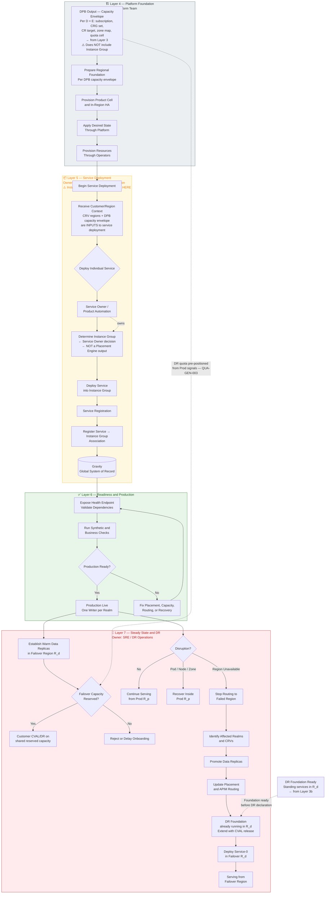

# ACRME End-to-End Deployment Chain with Placement Engine Ownership Layers

> **Revision 2** — Instance Group determination moved from DPB (Layer 3) to Service Deployment (Layer 5).
> DPB outputs the **capacity envelope** only. Service Owner determines IG.

## Ownership Boundary: What Is an Input vs an Output

| Concept | Role | Decided By |
|---------|------|------------|
| **Region placement** (CRV) | INPUT to service deployment | Placement Engine (Layer 2) |
| **Capacity envelope** (DPB) | INPUT to service deployment | Placement Engine (Layer 3) |
| **Instance Group** | OUTPUT of service deployment | Service Owner (Layer 5) |
| **Service → IG association** | Registration after deployment | Service Owner → Gravity (Layer 5) |

The Placement Engine tells service deployment **where** (regions) and **how much** (subscription, CRG set, CR sizing, zone targets, quota). The Service Owner then receives that context and decides **which Instance Group** to deploy into.

## Ownership Layer Summary

| Layer | Name | Owner | Scope | Key Outputs |
|-------|------|-------|-------|---------|
| 1 | Commercial / Customer Onboarding | Commercial Team | Per customer request | Geography, region input mode, seed check |
| 2 | Placement Engine: CRV Scope | Capacity and Placement Team | Customer × Geography — resolved once | CRV (R_p, R_c, R_d), seed record |
| 3 | Placement Engine: DPB Scope | Platform Engineering Team | Per Workload Group × Environment | Capacity envelope: subscription, CRG set, CR sizing, zone map, quota cell |
| 3b | DR Foundation Capacity | Platform Engineering Team | Domain wl-fnd — standing bootstrap | Foundation CRG sets, standing services, DR extension rule |
| 4 | Platform Foundation | Platform Team | Per region, per DPB output | Product cell, desired state, operators |
| 5 | Service Deployment | Service Owner / Product Automation | Per service | **Instance Group determination**, service → IG registration in Gravity |
| 6 | Readiness and Production | SRE / Operations | Per realm | Health, synthetic checks, production-live gate |
| 7 | Steady State and DR | SRE / DR Operations | Per customer across regions | Warm replicas, failover capacity, DR activation |

---

## Diagram 1 — Placement Engine: CRV and DPB Ownership Layers (Layers 1–3b)

```mermaid
flowchart TD

    %% ─── LAYER 1 — COMMERCIAL / CUSTOMER ONBOARDING ───
    subgraph L1["🏢 Layer 1 — Commercial / Customer Onboarding<br/>Owner: Commercial Team"]
        A[Customer Onboarding Request] --> B{Customer Exists?}
        B -->|Yes| SEED[Load Seed Record — PLC-004]
        B -->|No| GEO[Customer Selects Geography]
        GEO --> MODE{Region Input Mode?}
        MODE -->|Exact Region — PLC-001| EXACT[Customer Supplies R_p]
        MODE -->|Geography Only — PLC-002| GEO_PATH[Engine Derives R_p]
    end

    %% ─── LAYER 2 — PLACEMENT ENGINE: CRV SCOPE ───
    subgraph L2["🌍 Layer 2 — Placement Engine: CRV Scope<br/>Owner: Capacity and Placement Team<br/>Scope: Customer × Geography — resolved once"]
        subgraph EXACT_PATH["Exact-Region Path — PLC-001 default"]
            EXACT --> HC_GATE[HC Gate on R_p<br/>HC-1,4,5,8,9,10]
            HC_GATE -->|Pass| ANCHOR[R_p = Prod Anchor<br/>PS_Prod audit only]
            HC_GATE -->|Restricted| EXCEPT[Exception Workflow<br/>EC-1 to EC-4]
        end

        subgraph GEO_DERIVE["Geography Path — PLC-002 exception"]
            GEO_PATH --> CAND[Candidate Pool<br/>Standard regions in G]
            CAND --> SCORE[Score PS_Prod<br/>α Capacity + β Quota<br/>+ γ Fairness + δ DR + ε Zones]
            SCORE --> PICK[R_p = argmax PS_Prod]
            PICK -->|Lacks capacity| ALARM[Alarm — still place CVAL/DR]
        end

        ANCHOR --> DIST
        PICK --> DIST
        ALARM --> DIST

        DIST{Distribution Model — REG-003}
        DIST -->|3-region — US| D3[R_c = argmax PS_NonProd<br/>R_d = argmax PS_DR]
        DIST -->|2-region — EU,AU,APAC| D2[R_c = R_d = remaining<br/>Co-location mandatory]
        DIST -->|Cross-geo — ME| DX[R_c = R_p separate CRGs<br/>R_d in Europe Std]

        D3 --> CRV
        D2 --> CRV
        DX --> CRV

        CRV[CRV Output<br/>G, model, R_p, R_c, R_d<br/>Policy version — PLC-013]
        CRV --> PERSIST[Persist Seed — PLC-003]
    end

    SEED --> GATE
    PERSIST --> GATE
    GATE[PLC-015 Gate<br/>CRV precedes DPB<br/>No re-selection at domain scope]

    %% ─── LAYER 3 — PLACEMENT ENGINE: DPB SCOPE ───
    subgraph L3["⚙️ Layer 3 — Placement Engine: DPB Scope<br/>Owner: Platform Engineering Team<br/>Scope: Per Workload Group × Environment<br/>Outputs capacity envelope — does NOT determine Instance Group"]
        GATE --> DPB[DPB Engine — PLC-014<br/>For each D × E, R = CRV.E]
        DPB --> S1["① Subscription Assignment<br/>One per D × E<br/>SUB-GEN-001"]
        S1 --> S2["② CRG Set Assignment — CAP-025<br/>Prod → crg-pr dedicated<br/>CVAL/DR → crg-cvdr shared<br/>DR Fnd → crg-drf dedicated"]
        S2 --> S3["③ CR Sizing — F.1–F.3<br/>Target = Allocated + Buffer<br/>Headroom and Deficit"]
        S3 --> S4["④ Zone Distribution Targets — PLC-016<br/>VMs / ZoneCount per zone<br/>RegionZoneLoad = observe + alert only"]
        S4 --> S5["⑤ Quota Draw — QUA-015<br/>Central quota group per C × R × family<br/>85% replenishment thresholds"]
        S5 --> OUT["DPB Output — Capacity Envelope<br/>Per D × E: subscription, CRG set,<br/>CR target, zone map, quota cell<br/><br/>⚠️ Instance Group is NOT determined here<br/>It is an output of Service Deployment"]
    end

    %% ─── LAYER 3b — DR FOUNDATION ───
    subgraph L3b["🛡️ Layer 3b — DR Foundation<br/>Owner: Platform Engineering<br/>Domain: wl-fnd — standing bootstrap"]
        DPB --> FND[Foundation DPB<br/>Separate subs per env]
        FND --> FCGR[Foundation CRG Sets<br/>CVAL-Fnd + DR-Fnd<br/>Dedicated, pre-staged quota]
        FCGR --> FSVC[Standing Services<br/>IAM, APIM, Kafka<br/>Always running in R_d]
        FSVC --> FEXT[DR Extension<br/>Extend with CVAL release<br/>on DR declaration — DR-021]
    end

    OUT --> L4_HANDOFF["→ Layer 4: Platform Foundation<br/>→ Layer 5: Service Deployment"]
    FEXT -.->|Foundation ready<br/>before DR| L4_HANDOFF

    classDef l1 fill:#E8F5E9,stroke:#388E3C,color:#1B5E20
    classDef l2 fill:#E3F2FD,stroke:#1976D2,color:#0D47A1
    classDef l3 fill:#FFF3E0,stroke:#F57C00,color:#E65100
    classDef l3b fill:#F3E5F5,stroke:#7B1FA2,color:#4A148C
    class L1 l1
    class L2 l2
    class L3 l3
    class L3b l3b
```

---

## Diagram 2 — Deployment Chain: Service Deployment Owns Instance Group (Layers 4–7)

---

## Key Change from Revision 1

**Instance Group binding removed from DPB (Layer 3) and moved to Service Deployment (Layer 5).**

The principle:
- **Region placement is an input to service deployment.** CRV and DPB tell the Service Owner which regions, which subscription, which CRG sets, how much capacity, which zones, and what quota — all of which are decided before the service deploys.
- **Instance Group is an output/decision of service deployment.** The Service Owner's deployment automation determines the appropriate IG based on the received capacity context. This is NOT a Placement Engine decision.
- **Service → IG association is registered after deployment.** Gravity maintains the central record.

### DPB now outputs (5 steps, was 6):

| Step | What DPB Decides | Requirement |
|------|-----------------|-------------|
| ① Subscription | One per D × E | SUB-GEN-001 |
| ② CRG Set | Prod dedicated, CVAL/DR shared, DR Fnd dedicated | CAP-025 |
| ③ CR Sizing | Target = Allocated + Buffer, headroom, deficit | F.1–F.3 |
| ④ Zone Targets | VMs per zone, skew tolerance, region load observe-only | PLC-016 |
| ⑤ Quota Draw | Central group, 85% thresholds | QUA-015 |

### Service Deployment now owns (moved from DPB):

| Step | What Service Owner Decides | Registration |
|------|---------------------------|-------------|
| Instance Group | Which IG to deploy into, based on DPB context | Service → IG in Gravity |

---

## Cross-Layer Governance Links (dashed)
- DR Foundation services (Layer 3b) → DR activation boot (Layer 7)
- DR quota pre-positioned from Prod demand (Layer 3 QUA-015) → failover capacity gate (Layer 7)
- CRV output (Layer 2) → reused by all DPB iterations (Layer 3)
