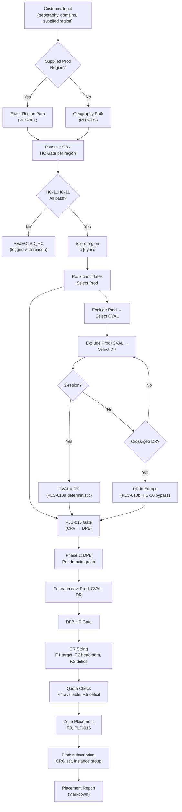

# ACRME Placement Engine — End-User Guide

> **Version:** 1.0 | **Engine Branch:** `feat/placement-engine-mockup` | **PR:** [#11](https://github.com/vishnu4573/acrme-capacity-reservation/pull/11)

This guide explains **what the Placement Engine does**, **how to run it**, and **how to read and interpret the output** — whether you are validating the CRV → DPB pipeline with mock data or running it against real Azure capacity snapshots.

---

## Table of Contents

1. [What Is the Placement Engine?](#1-what-is-the-placement-engine)
2. [Pipeline Flow](#2-pipeline-flow)
3. [Prerequisites](#3-prerequisites)
4. [Quick Start — Running with Mock Data](#4-quick-start--running-with-mock-data)
5. [CLI Reference](#5-cli-reference)
6. [Test Walkthrough — Three Mock Customers](#6-test-walkthrough--three-mock-customers)
7. [Reading the Placement Report](#7-reading-the-placement-report)
8. [Supplying Your Own Inputs](#8-supplying-your-own-inputs)
9. [Using the Azure Data Collector](#9-using-the-azure-data-collector)
10. [Adjusting Scoring Weights & Policy](#10-adjusting-scoring-weights--policy)
11. [Troubleshooting](#11-troubleshooting)
12. [Glossary](#12-glossary)

---

## 1. What Is the Placement Engine?

The Placement Engine is a **Python mockup** that implements the ACRME two-phase region-selection and domain-placement pipeline:

1. **CRV (Customer Region Vector)** — selects the Prod, CVAL, and DR regions for a customer across all domain groups.
2. **DPB (Domain Placement Binding)** — binds each domain group to a subscription, CRG set, CR sizing, and quota draw in the regions chosen by CRV, with zone-level placement.

Every candidate region is evaluated through a **Hard-Constraint (HC) gate** (HC-1 through HC-11) and then **scored** using five weighted factors (α–ε). The engine produces a detailed Markdown report showing the full selection/rejection trail at region, environment, and availability-zone level.

The engine supports three distribution models:

| Model | Geographies | Prod | CVAL | DR |
|---|---|---|---|---|
| `three_region` | US | R_p | R_c (≠ R_p) | R_d (≠ R_p, ≠ R_c) |
| `two_region` | EU, AU, APAC | R_p | R_c = R_d (co-located) | R_c = R_d |
| `cross_geography_dr` | Middle East | R_p = R_c (same region, separate CRGs) | co-located with Prod | Europe (cross-geo weighted) |

---

## 2. Pipeline Flow

The end-to-end placement pipeline follows this sequence:



### Phase 1 — CRV (Customer Region Vector)

CRV is **customer-scoped**: the same Prod / CVAL / DR regions apply to all domain groups for a given customer (the CRV is resolved once and reused).

The resolution path depends on whether the customer supplies a preferred Prod region:

- **Exact-Region Path (PLC-001):** The supplied region is validated through the HC gate. If it passes, it becomes R_prod. CVAL and DR are then selected from remaining candidates by scoring.
- **Geography Path (PLC-002):** All standard regions in the customer's geography are scored; the highest-scoring region becomes R_prod, and so on.

Placement order is sequential: **Prod → CVAL → DR**. Each subsequent environment excludes already-selected regions (for the three-region model).

### Phase 2 — DPB (Domain Placement Binding)

DPB is **domain-group-scoped**: for each domain group (e.g., TMS, WMS), the engine binds the CRV-chosen regions to:

- **Subscription** — the domain group's environment-specific subscription
- **CRG Set Type** — `crg-pr` (Prod dedicated), `crg-cvdr` (CVAL/DR shared), or `crg-drf` (DR Foundation)
- **CR Sizing** — target reserved capacity (F.1), headroom check (F.2), deficit calculation (F.3)
- **Quota Draw** — available quota (F.4), deficit (F.5), replenishment flag (QUA-015)
- **Zone-Level Placement** — per-zone target VMs, skew checks (C-13), and rebalance flags

### Hard Constraints (HC-1 through HC-11)

| HC | What It Checks |
|---|---|
| HC-1 | Region must be in the approved catalogue |
| HC-2 | Target SKU availability in the region |
| HC-3 | Per-environment capacity reservation exists |
| HC-4 | Region has ≥ 3 availability zones |
| HC-5 | Zone skew within tolerance (C-13) |
| HC-6 | DR region ≠ Prod region |
| HC-7 | CVAL region ≠ Prod region (3-region model only) |
| HC-8 | Restricted-region auto-selection blocked |
| HC-9 | Quota headroom sufficient for demand |
| HC-10 | Combined load below alert threshold (C-15) |
| HC-11 | DR Foundation capacity available |

A region that fails **any** HC is marked `REJECTED_HC` and logged with the specific reason. It does not proceed to scoring.

### Scoring Factors (α – ε)

| Factor | Weight | What It Measures |
|---|---|---|
| α (alpha) | 0.30 [Assumed] | Capacity headroom — free slots relative to reserved |
| β (beta) | 0.20 [Assumed] | Quota headroom — remaining quota relative to limit |
| γ (gamma) | 0.25 [Assumed] | Fairness — inverse of customer concentration (F.10) |
| δ (delta) | 0.15 [Assumed] | DR readiness — NonProd free capacity ratio |
| ε (epsilon) | 0.10 [Assumed] | Zone diversity — evenness of zone-level allocation |

> **Important:** All weight values are labelled `[Assumed]` and are **not** approved production defaults. They are tunable via the `PlacementPolicy` object.

---

## 3. Prerequisites

- **Python 3.10+** (the engine uses `match` statements, `dict |` unions, modern type hints)
- **No pip install needed** for mock-data mode — the engine uses only the Python standard library
- **For Azure data collection only:** `pip install -r requirements.txt` (installs `azure-identity`, `azure-mgmt-compute`, `azure-mgmt-quota`, `azure-mgmt-reservations`, `azure-mgmt-resource`, `azure-mgmt-resourcegraph`)

---

## 4. Quick Start — Running with Mock Data

```bash
# 1. Navigate to the Placement-Engine directory
cd Placement-Engine

# 2. Run all three mock customers
python run_mockup.py

# 3. Open the generated report
cat placement_report.md
```

That's it. The engine ships with three pre-built customers (Contoso in US, Fabrikam in EU, Litware in ME) and synthetic region snapshots. No Azure credentials, no pip install, no configuration files.

The output will show:

```
============================================================
Placement report written to: /path/to/Placement-Engine/placement_report.md
Customers processed: 3
============================================================
```

---

## 5. CLI Reference

```
python run_mockup.py [OPTIONS]
```

| Flag | Short | Default | Description |
|---|---|---|---|
| `--customer` | `-c` | _(all)_ | Run for a single customer ID (e.g., `cust-001`) |
| `--output` | `-o` | `placement_report.md` | Output Markdown report filename |
| `--verbose` | `-v` | off | Enable debug-level logging to console |
| `--data-dir` | `-d` | _(mock)_ | Directory with Azure-collected JSON files |
| `--geography` | `-g` | _(all)_ | Geography filter (required with `--data-dir`) |

### Example Commands

```bash
# All customers, default output
python run_mockup.py

# Single customer with verbose logging
python run_mockup.py -c cust-001 -v

# Custom output filename
python run_mockup.py -o us_placement.md

# Azure-collected data for US geography
python run_mockup.py --data-dir ./data --geography US

# Combine: single customer, verbose, custom output
python run_mockup.py -c cust-003 -v -o litware_report.md
```

---

## 6. Test Walkthrough — Three Mock Customers

The mock data defines three customers that exercise all three distribution models. Here is what to expect when you run `python run_mockup.py`.

### 6.1 Contoso Ltd (`cust-001`) — US, three_region

| Property | Value |
|---|---|
| Geography | US |
| Distribution Model | `three_region` |
| Supplied Prod Region | `westus3` (exact-region path) |
| Domain Groups | TMS (64/32/32 vCPU) + WMS (32/16/16 vCPU) |

**Expected CRV Result:**

| Environment | Selected Region | Path |
|---|---|---|
| Prod | `westus3` | exact_region (supplied, HC-validated) |
| CVAL | `canadacentral` | geography (scored, R_c ≠ R_p) |
| DR | `centralus` | geography (scored, R_d ≠ R_p ≠ R_c) |

**Expected DPB Result (TMS):**

| Environment | Region | CRG Set | Target Reserved |
|---|---|---|---|
| Prod | westus3 | `crg-pr` | 64 vCPU |
| CVAL | canadacentral | `crg-cvdr` | 32 vCPU |
| DR | centralus | `crg-cvdr` | 32 vCPU |

**What to verify:**
- Prod region matches the supplied `westus3` (exact-region path, not scored for selection)
- CVAL and DR are different from each other and from Prod (three distinct regions)
- WMS domain group follows the same CRV regions but with its own sizing (32/16/16)
- HC gate table shows all checks passing for selected regions

### 6.2 Fabrikam Inc (`cust-002`) — Europe, two_region

| Property | Value |
|---|---|
| Geography | Europe |
| Distribution Model | `two_region` |
| Supplied Prod Region | _(none — geography path)_ |
| Domain Groups | TMS (48/24/24 vCPU) |

**Expected CRV Result:**

| Environment | Selected Region | Path |
|---|---|---|
| Prod | `swedencentral` | geography (scored, highest-ranking) |
| CVAL | `switzerlandnorth` | 🔒 deterministic (PLC-010a) |
| DR | `switzerlandnorth` | 🔒 deterministic (co-located with CVAL) |

**What to verify:**
- Geography path was used (no supplied region)
- CVAL and DR are co-located in the same remaining standard region (PLC-010a)
- Report shows "Deterministic co-location" labels, not scoring tables for CVAL/DR
- Only two distinct regions used (2-region model)

### 6.3 Litware Corp (`cust-003`) — Middle East, cross_geography_dr

| Property | Value |
|---|---|
| Geography | Middle East |
| Distribution Model | `cross_geography_dr` |
| Supplied Prod Region | `qatarcentral` |
| Domain Groups | TMS (32/16/16 vCPU) |

**Expected CRV Result:**

| Environment | Selected Region | Path |
|---|---|---|
| Prod | `qatarcentral` | exact_region (supplied) |
| CVAL | `qatarcentral` | 🌍 cross-geo (PLC-010b, co-located with Prod, separate CRGs) |
| DR | `switzerlandnorth` | 🌍 cross-geo (DR-020, placed in Europe) |

**What to verify:**
- Prod and CVAL share the same region (`qatarcentral`) but use separate CRG sets
- DR is in Europe (cross-geo), not in the Middle East geography
- Report shows the cross-geo DR label with HC-10 bypass (instead of HC-8 geography check)
- Europe region candidates are scored for the DR slot

---

## 7. Reading the Placement Report

The generated `placement_report.md` follows a consistent structure for each customer. Here is a section-by-section guide.

### 7.1 Report Header

```markdown
# ACRME Placement Report

**Customer:** Contoso Ltd (`cust-001`)
**Geography:** US
**Domain Groups:** TMS, WMS
**Policy Version:** v1.0-mock
**Timestamp:** 2026-11-13T...
**Overall Status:** `COMPLETED`
```

The header identifies the customer, their geography, all domain groups processed, and the policy version.

### 7.2 Customer Demand Summary

A table listing each domain group's vCPU demand per environment:

| Domain | Prod vCPU | CVAL vCPU | DR vCPU | SKU Family |
|---|---|---|---|---|
| TMS | 64 | 32 | 32 | Dadsv5 |
| WMS | 32 | 16 | 16 | Dadsv5 |
| **Total** | **96** | **48** | **48** | |

### 7.3 Phase 1 — CRV

Shows the resolution path (`exact_region` or `geography`) and the CRV result table:

| Environment | Selected Region |
|---|---|
| Prod | `westus3` |
| CVAL | `canadacentral` |
| DR | `centralus` |

#### Prod Region Selection (Exact-Region Path)

For exact-region customers, the report shows:
- The **supplied region** and whether it was accepted or rejected
- The **HC Gate table** with per-constraint pass/fail and detail text
- An **audit score** (computed but not used for selection — for comparison only)

#### Prod Region Selection (Geography Path)

For geography-path customers, the report shows a **scoring table**:

| Region | α (30%) | β (20%) | γ (25%) | δ (15%) | ε (10%) | **Score** | HC | Decision |
|---|---|---|---|---|---|---|---|---|
| swedencentral | 0.075 | 0.112 | 0.167 | 0.098 | 0.082 | **0.534** | ✅ | ✅ SELECTED |
| switzerlandnorth | 0.060 | 0.098 | 0.145 | 0.085 | 0.070 | **0.458** | ✅ | ⚠️ REJECTED_SCORING |

**Icons:**
- ✅ SELECTED — region chosen for this environment
- ❌ REJECTED_HC — failed a hard constraint (check the rejection details below the table)
- ⚠️ REJECTED_SCORING — passed HC but lost on score to a better candidate
- 🔒 DETERMINISTIC — co-located by rule (PLC-010a, 2-region model)
- 🌍 CROSS_GEO — cross-geography placement (PLC-010b, ME DR)

#### CVAL and DR Selection

Depends on the distribution model:
- **three_region:** full scoring tables (same format as Prod), with already-selected regions excluded
- **two_region:** "Deterministic co-location" message (no scoring needed)
- **cross_geography_dr:** CVAL shows co-location message; DR shows scoring of Europe candidates

### 7.4 Phase 2 — DPB

For each domain group and each environment, the report shows:

#### Binding Properties

| Property | Value |
|---|---|
| Instance Group | `tms-prod-westus3` |
| Subscription | `sub-prod-001` |
| CRG Set Type | `crg-pr` |
| Target Reserved (F.1) | 64 vCPU |
| Headroom (F.2) | 96 vCPU |
| Deficit (F.3) | 0 vCPU |
| Available Quota (F.4) | 280 vCPU |
| Quota Deficit (F.5) | 0 vCPU |
| Quota Replenish Needed | No |

**Key fields to check:**
- **Deficit (F.3):** If > 0, the region does not have enough reserved capacity for this domain's demand. The new reservation must be created or expanded.
- **Quota Deficit (F.5):** If > 0, insufficient quota exists; a quota increase request is needed before deployment.
- **Quota Replenish Needed:** Flagged YES ⚠️ when quota usage exceeds the replenishment threshold (QUA-015, default 85%).

#### DPB HC Gate

A separate HC gate table for the DPB phase (verifying the chosen region still satisfies constraints at the domain level).

#### Zone-Level Placement

| Zone | Target | Current | Skew | Rebalance | CRG | Avail Slots | Quota Avail |
|---|---|---|---|---|---|---|---|
| Zone 1 | 22 | 20 | +2 | — | `crg-pr-westus3-z1` | 40 | 93 |
| Zone 2 | 21 | 20 | +1 | — | `crg-pr-westus3-z2` | 30 | 93 |
| Zone 3 | 21 | 20 | +1 | — | `crg-pr-westus3-z3` | 30 | 93 |

- **Target:** VMs to place in this zone (round-robin from total demand)
- **Skew:** Difference from even distribution; flagged if exceeds zone_skew_tolerance (C-13)
- **Rebalance:** ⚠️ YES if skew exceeds tolerance and VMs should be rebalanced
- **CRG:** The per-zone CRG name (CAP-023 zone-aligned CRGs)

### 7.5 Summary Table

A consolidated view at the end of each customer's report:

| Domain | Environment | Region | Status | Deficit | Quota Deficit |
|---|---|---|---|---|---|
| wl-tms | Prod | westus3 | ✅ | 0 | 0 |
| wl-tms | CVAL | canadacentral | ✅ | 0 | 0 |
| wl-tms | DR | centralus | ✅ | 0 | 0 |
| wl-wms | Prod | westus3 | ✅ | 0 | 0 |

Look for any ❌ rows — these indicate placement failures that need attention.

---

## 8. Supplying Your Own Inputs

### 8.1 Adding a New Mock Customer

Edit `mock_data.py` and add a `Customer` object to the `build_customers()` list:

```python
from models import Customer, DomainGroup

Customer(
    customer_id="cust-new",
    customer_name="Acme Corp",
    geography="US",                       # must match region data key
    supplied_prod_region="westus3",       # or None for geography path
    domain_groups=[
        DomainGroup(
            token="wl-tms",
            display_name="TMS",
            prod_vcpu_demand=64,
            cval_vcpu_demand=32,
            dr_vcpu_demand=32,
            sku_family="Dadsv5",
            prod_subscription_id="sub-prod-001",
            cval_subscription_id="sub-cval-001",
            dr_subscription_id="sub-dr-001",
        ),
    ],
)
```

Then run:

```bash
python run_mockup.py -c cust-new -v
```

### 8.2 Adding or Modifying Region Data

Region snapshots live in `mock_data.py` within `build_us_regions()`, `build_eu_regions()`, `build_me_regions()`. Each region is a `RegionSnapshot` object with capacity, quota, customer counts, and zone-level detail.

Key fields in `RegionSnapshot`:

| Field | Purpose |
|---|---|
| `region_id` | Azure region identifier (e.g., `westus3`) |
| `geography` | Geography group (e.g., `US`) |
| `classification` | `RegionClassification.STANDARD` or `RESTRICTED` |
| `distribution_model` | `DistributionModel.THREE_REGION`, `TWO_REGION`, or `CROSS_GEO_DR` |
| `availability_zones` | Number of AZs (must be ≥ 3 for HC-4) |
| `auto_selectable` | `True` for standard, `False` for restricted (HC-8) |
| `prod_reserved`, `prod_allocated`, `prod_free` | Prod capacity in the region |
| `cval_reserved`, `cval_allocated`, `cval_free` | CVAL capacity |
| `dr_reserved`, `dr_allocated`, `dr_free` | DR capacity |
| `fnd_dr_reserved`, `fnd_dr_allocated`, `fnd_dr_free` | DR Foundation capacity (separate from workload DR) |
| `customers_prod`, `customers_cval`, `customers_dr`, `total_geography_customers` | Customer counts for γ-fairness |
| `dr_destination_geography` | For cross-geo regions (e.g., `"Europe"` for ME regions) |

### 8.3 Using Azure-Collected JSON

Instead of modifying `mock_data.py`, you can feed the engine real Azure data via the `--data-dir` flag. The JSON schema is documented in the README. The collector produces files named `regions_<geography>.json` (e.g., `regions_us.json`, `regions_europe.json`).

```bash
# Step 1: Collect
python azure_collector.py -s sub-1 sub-2 -g US -o ./data

# Step 2: Run
python run_mockup.py --data-dir ./data --geography US
```

For cross-geo DR (Middle East), collect **both** ME and Europe data into the same `--output-dir`.

---

## 9. Using the Azure Data Collector

The `azure_collector.py` script gathers live capacity, quota, and reservation data from your Azure subscriptions and writes it in the JSON format the engine consumes.

### Prerequisites

```bash
pip install -r requirements.txt
az login   # or use a service principal / managed identity
```

### Usage

```bash
python azure_collector.py \
    --subscriptions sub-id-1 sub-id-2 sub-id-3 \
    --geography US \
    --sku-family Dadsv5 \
    --output-dir ./data
```

| Flag | Short | Description |
|---|---|---|
| `--subscriptions` | `-s` | Space-separated list of subscription IDs to query |
| `--geography` | `-g` | Geography to collect (US, Europe, Middle East, etc.) |
| `--sku-family` | `-k` | SKU family to filter on (default varies) |
| `--output-dir` | `-o` | Output directory (default `./data`) |

The collector uses `DefaultAzureCredential` and queries:
- **Azure Resource Graph** for CRGs and Capacity Reservations
- **Compute Usage API** for quota per SKU family
- **ARM** for subscription and region metadata

> **Note:** The collector has not been tested against live Azure environments. Validate the output JSON structure before using it for production decisions.

### Data Pre-Collection Checklist

Before running the engine against real data, ensure you have:

| # | Data | Source |
|---|---|---|
| 1 | Capacity Reservation Groups | Resource Graph |
| 2 | Capacity Reservations per CRG | Resource Graph |
| 3 | VM instances using CRs | Resource Graph |
| 4 | Quota usage per SKU family | `az vm list-usage --location <region>` |
| 5 | Subscription list | `az account list` |
| 6 | Region catalogue | `environment.yaml` (static configuration) |
| 7 | Customer demand (vCPUs per domain group) | Onboarding system |
| 8 | Customer count per region | Internal tracking (for γ-fairness) |

---

## 10. Adjusting Scoring Weights & Policy

The engine's behaviour is controlled by a `PlacementPolicy` object. All weights and thresholds are tunable.

```python
from models import PlacementPolicy

policy = PlacementPolicy(
    alpha=0.30,    # capacity headroom weight  [Assumed]
    beta=0.20,     # quota headroom weight     [Assumed]
    gamma=0.25,    # fairness weight           [Assumed]
    delta=0.15,    # DR readiness weight       [Assumed]
    epsilon=0.10,  # zone diversity weight     [Assumed]
    zone_skew_tolerance=2,                   # C-13
    combined_load_alert_threshold=0.85,      # C-15
    quota_group_replenish_threshold=0.85,    # QUA-015
    quota_sub_replenish_threshold=0.85,      # QUA-015
    dr_sizing_method="max_not_sum",          # DR-017
)
```

The five weights (α + β + γ + δ + ε) **must sum to 1.0**. The `PlacementPolicy.validate()` method enforces this invariant at startup.

To experiment with different weights, edit the `default_policy()` function in `mock_data.py` and re-run:

```bash
python run_mockup.py -v
```

Compare report outputs to see how weight changes affect region ranking.

> **Known design gap:** In NonProd scoring, α (capacity headroom) and δ (DR readiness) both draw from `NP_Eff_Free / NP_Reserved`, giving NP headroom an effective combined weight of 0.45. This is documented and tracked.

---

## 11. Troubleshooting

| Symptom | Cause | Fix |
|---|---|---|
| `ModuleNotFoundError: No module named 'models'` | Running from wrong directory | `cd Placement-Engine` before running |
| `SyntaxError: ... match ...` | Python < 3.10 | Upgrade to Python 3.10+ |
| `Policy weight-sum invariant violated — aborting` | α+β+γ+δ+ε ≠ 1.0 | Fix weights in `default_policy()` or `PlacementPolicy()` |
| `No region data for geography 'X'` | Customer geography doesn't match any region key | Check `build_all_regions()` keys or `--geography` flag |
| `Customer 'X' not found in mock data` | Typo in `-c` flag | Use `cust-001`, `cust-002`, or `cust-003` |
| `--geography is required when using --data-dir` | Missing `-g` flag | Add `-g US` (or the target geography) |
| Azure collector fails with `DefaultAzureCredential` error | Not authenticated | Run `az login` first |
| `FileNotFoundError: No Azure data found at ...` | Collector not run yet | Run `python azure_collector.py` first for that geography |
| All regions REJECTED_HC for DR in cross-geo | Europe data not loaded | Engine auto-loads Europe mock; for Azure data, collect Europe too |

---

## 12. Glossary

| Term | Full Name | Description |
|---|---|---|
| **CRV** | Customer Region Vector | Phase 1 output: the three regions (Prod, CVAL, DR) selected for a customer, applied to all domain groups |
| **DPB** | Domain Placement Binding | Phase 2 output: per-domain-group binding of subscription, CRG set, CR sizing, and quota draw |
| **HC** | Hard Constraint | A binary pass/fail gate (HC-1 through HC-11) that a region must clear before scoring |
| **CRG** | Capacity Reservation Group | Azure resource that groups capacity reservations; one CRG per environment grouping per zone per domain |
| **CR** | Capacity Reservation | Azure resource guaranteeing compute capacity within a CRG |
| **CVAL** | Customer Validation | Non-production environment for customer acceptance testing |
| **DR** | Disaster Recovery | Standby environment for business continuity |
| **DR Foundation** | Foundation DR Capacity | Standing capacity for foundation services (IAM, APIM, Kafka) — structurally separate from workload DR capacity, bootstrapped with guaranteed capacity |
| **CRG Set Type** | — | `crg-pr` (Prod dedicated), `crg-cvdr` (CVAL/DR shared), `crg-drf` (DR Foundation) |
| **α, β, γ, δ, ε** | Scoring Weights | Alpha (capacity headroom), Beta (quota headroom), Gamma (fairness), Delta (DR readiness), Epsilon (zone diversity) |
| **F.1–F.13** | Formula References | Formulas from the ACRME Requirements Baseline v4.0, §21 |
| **PLC-001** | Exact-Region Path | Customer supplies a preferred Prod region |
| **PLC-002** | Geography Path | All standard regions scored; exception-only path |
| **PLC-010a** | 2-Region Co-Location | CVAL and DR share the same region (deterministic) |
| **PLC-010b** | Cross-Geo DR | DR placed in a different geography (ME → Europe) |
| **PLC-015** | CRV → DPB Gate | CRV must complete successfully before DPB begins |
| **CAP-023** | Zone-Aligned CRGs | CRGs are per-zone within a region |
| **QUA-015** | Quota Replenishment | Threshold-based quota replenishment alerting |
| **DR-017** | Max-Not-Sum DR Sizing | DR capacity sized to the maximum single-domain demand, not the sum |
| **C-13** | Zone Skew Tolerance | Maximum allowed VM count difference between zones |
| **C-15** | Combined Load Alert | Alert when total load exceeds threshold |

---

## Appendix — File Map

| File | Purpose |
|---|---|
| `run_mockup.py` | CLI entry point — parses arguments, loads data, runs pipeline, writes report |
| `engine.py` | Core pipeline: `resolve_crv()` (Phase 1) and `run_placement()` (Phase 1 + Phase 2) |
| `hard_constraints.py` | HC-1 through HC-11 implementations, `run_crv_hc_gate()`, `run_dpb_hc_gate()` |
| `scoring.py` | `score_prod()`, `score_nonprod()`, `score_dr()`, `gamma_fairness()` (F.1–F.10) |
| `models.py` | All data structures: `RegionSnapshot`, `Customer`, `DomainGroup`, `PlacementPolicy`, `CRVResult`, `DPBResult`, etc. |
| `report.py` | Markdown report generator: `generate_report()` |
| `mock_data.py` | Synthetic data: `build_us_regions()`, `build_eu_regions()`, `build_me_regions()`, `build_customers()`, `default_policy()` |
| `azure_collector.py` | Azure SDK-based data collector: `AzureCapacityCollector`, CLI |
| `requirements.txt` | Python dependencies (Azure SDKs — needed only for live collection) |
